# Rewind

**A world model that runs time backwards.**

Show Rewind one photo of an aftermath, such as a car against a guardrail, a broken vase or a fallen shelf, and Meta's AI works out **what happened before, and why**.
1. **It reads the evidence in the photo** and pins each piece on it: tyre marks, where the damage came from, where things ended up, how far debris spread, the road, the weather and the light.
2. **It works backwards with physics.** It gives 2–4 possible explanations, ranked by likelihood. Each has a direction of travel, estimated speeds, angles and forces, the evidence for and against it, and what could have prevented it.
3. **It paints the moments before, in the same real place.** Muse Image changes the photo itself, going backwards: 1 second before, then 3, then 10. Anything made later, like tyre marks or dents, isn't there yet. Press **Play** to watch it happen, ending on the real photo.

World models usually predict the future. Rewind runs one backwards, from effect to cause, with its reasoning shown and painted. Uses include accident and insurance reports, safety lessons, and everyday mysteries ("what broke the vase?").

Built for the Meta Global AI Developer Hackathon (Oct 26 – Nov 4, 2026). Track: Indie. Theme: Push the Frontier.

| Give it a photo | The evidence and the explanations | 10 seconds before | 1 second before |
|---|---|---|---|
| 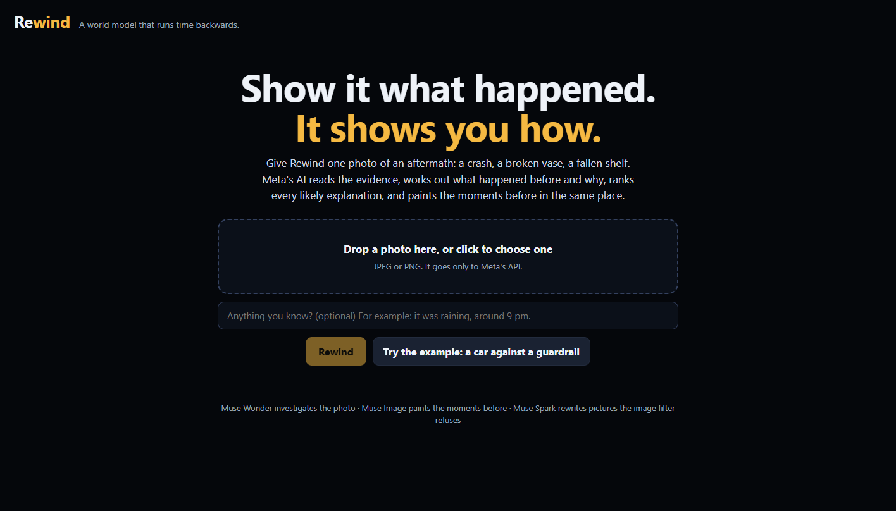 |  | 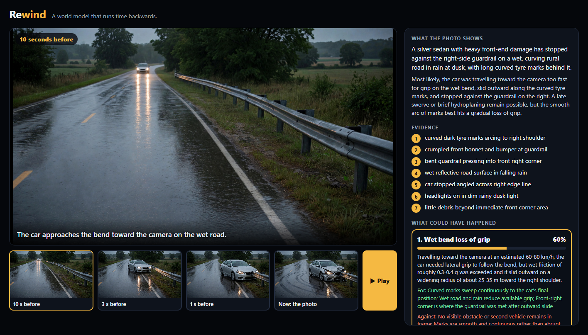 | 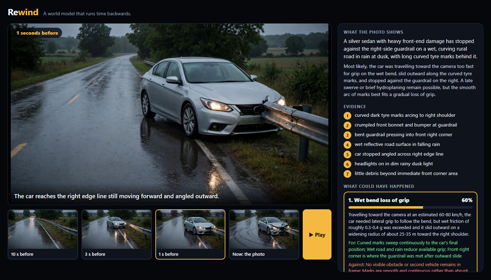 |

**Try it:** put your Meta API key in `.env` (`MODEL_API_KEY=…`), run `npm start`, and open **http://localhost:3000/rewind.html**. Drop a photo or click the example.

| Job | Meta model |
|---|---|
| The investigator: evidence, explanations, physics and timelines, from the photo | `muse-wonder-1.0` (vision) |
| The painter: the moments before, by changing the real photo backwards | `muse-image-1.0` |
| Rewrites a picture in calmer words if the image filter refuses it | `muse-spark-1.3` |

- **Speed and cost (measured):** the investigation takes about 23–26 s, and painting 3 moments about 33 s. A case costs about $0.11: around $0.08 for the investigation and $0.01 per moment.
- **Honest limits:**
  - These are *possible* explanations from what one photo shows, not an official finding.
  - The painted moments are reconstructions of one explanation, not footage.
  - It never paints the contact itself, injuries or faces.

The code is in `src/rewind/engine.ts` (the investigation and backward painting), `public/rewind.html` and `rewind.js` (the page), and `test/rewind.test.ts`.

---

## How we got here: Home Heist, Speak Any Game and No Engine

Before Rewind, this repo grew through world-model experiments. They all still run, and the [build log](docs/BUILD_LOG.md) records each step.

### Home Heist

**Every trick works once.**

Home Heist is a stealth game set in a real place. You are a thief who must steal one object and get out.

- An AI **world model** decides what happens when anyone acts. Nobody hand-writes the game's rules.
- AI **guards** protect the target. After every round they lose, they write your trick in their notebook, so it never works twice.
- A **teacher** AI checks the world model against the real room and corrects its mistakes. The world gets more accurate the more it is played.

Built for the Meta Global AI Developer Hackathon (Oct 26 – Nov 4, 2026). Track: Indie. Theme: Push the Frontier.

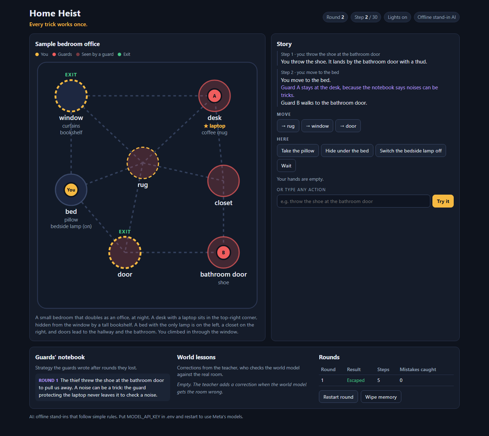

> **Status on Oct 28, 2026: a small working demo.**
> The game, the learning guards and the teacher run with *offline stand-ins*: simple hand-written rules that need no API key.
> They also run on **Meta's models**. On Oct 28, real rounds played with no errors, at about 2–4 seconds and 1 cent per step. The teacher (Muse Wonder) found the planted world-model mistake by itself.
> See [What works today](#what-works-today).

### Newest: No Engine. A game with no game code (Nov 2)

Start the server, then open **http://localhost:3000/paint.html**. Say or type any world, then play it by saying or typing what you do.
- **There is no 3D engine, no physics code and no graphics code.** Meta's AI is the whole game engine.
- **Muse Spark** invents the world from your words, keeps all its facts (they are the entire state of the game), and decides what happens on every move, other characters included.
- **Muse Image** paints every frame by changing the last one, so the world stays the same place and remembers what happened: throw your shoe, and you are barefoot in the next frame.
- **Muse Wonder** makes the characters remember you. After a round, "Play again" opens the same world, but the guards now know your tricks.
- **Muse Voice** lets you speak the world and every move.
- **Speed and cost:** each move takes about 15–35 seconds (about 5 s to decide, 10–25 s to paint) and costs about $0.012.

| Say any world | "Raise every sail" | "Fire a flare to blind their lookout" | Round 2: the guards remember you |
|---|---|---|---|
| 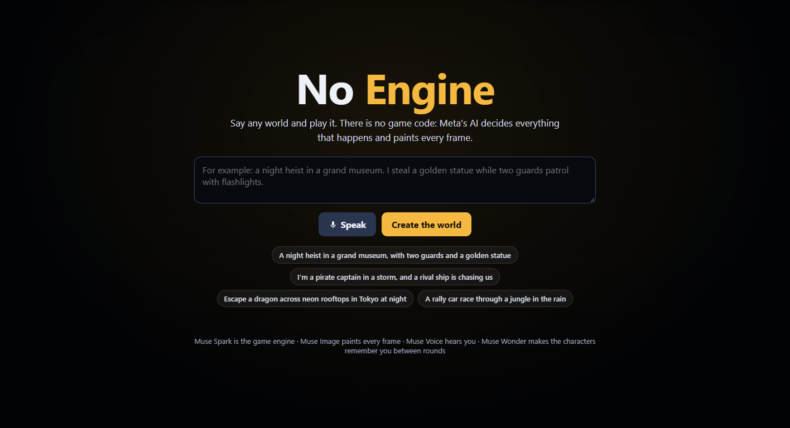 | 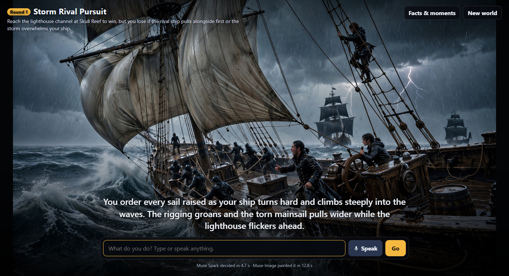 | 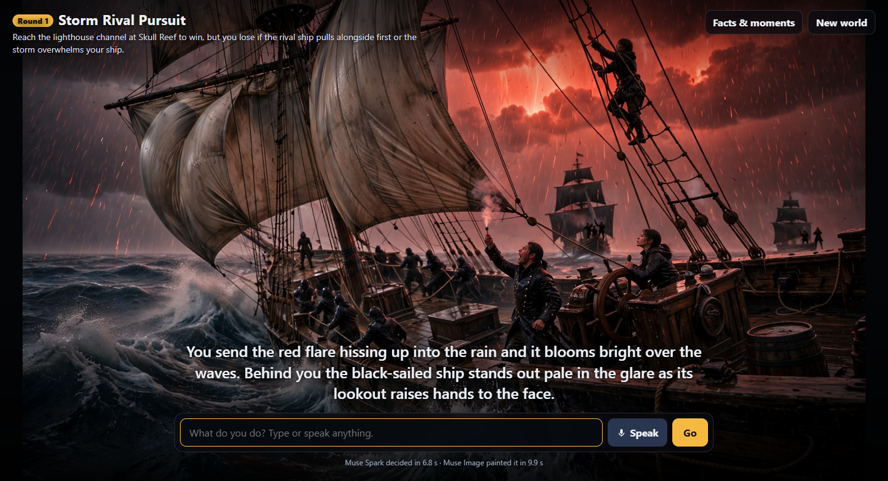 | 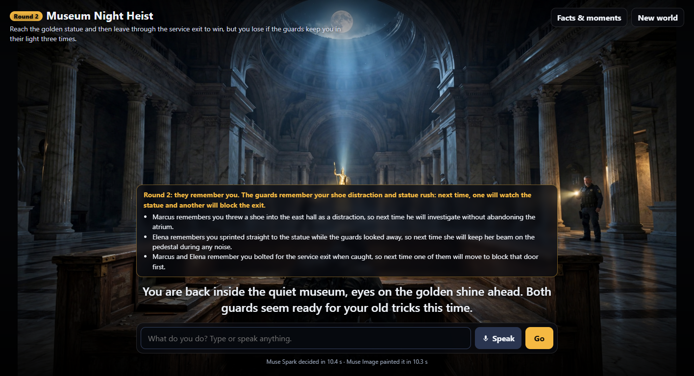 |

### Meta's AI inside every game (Nov 2)

Every game the AI writes now has **Meta's world model running while you play**. This brings Home Heist's world model to any game.
- **Try anything.** Press **Enter** in any game and type or say anything: "drop a coin to distract the guards", "pour oil on the track", "build a fence around chicken 2". Muse Spark decides what really happens and the game shows it. Creative ideas work, often with a catch. Cheating ("I win now") doesn't.
- **Characters think for themselves.** Rivals, guards and animals each get a mind (Muse Spark). Every few seconds it chooses their plan from what that character can see, and sometimes they say something.
- **They learn.** After every win or loss, Muse Wonder studies the round and writes lessons for the world and for each character. The next round starts by showing what they learned, and they play differently, so the same trick may not work twice.
- **Safety:** the game still runs sealed. It can only ask the page around it, which passes a few questions at a time to the server. The server checks every request, lets the model choose only changes the game offers, and stops at $2 of AI per run of the server.
- **Cost and speed:** about 2–3 seconds and $0.002 per answer. Learning after a round (Muse Wonder) took 6 seconds and $0.03 in our test.

| You try something: the world decides | After the round: Muse Wonder learns | Next round: the fox plays its lessons |
|---|---|---|
| 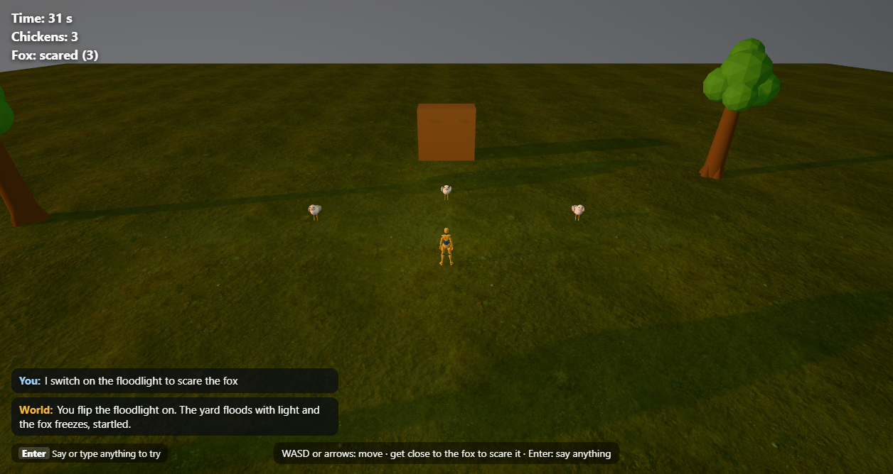 | 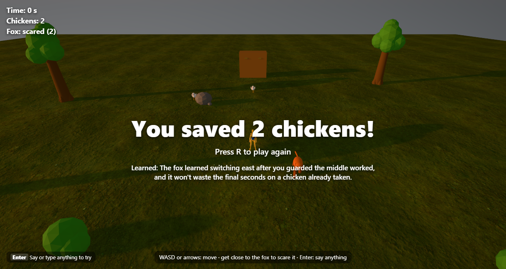 | 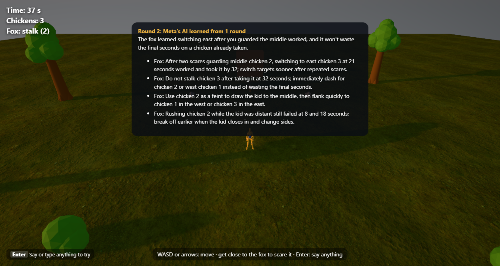 |

### Speak Any Game. The AI writes the game itself (Oct 29)

Start the server, then open **http://localhost:3000/make.html**. Say or type any game: racing, platformer, puzzle, shooter, farming, anything.
- **Meta's Muse Wonder writes the whole game as code:** its rules, controls, levels, and how you win or lose. It uses our game kit: 3D worlds, animated people and creatures, ready-made things, cameras, sound and a score display.
- **A hidden test browser plays it.** Any errors go back to be fixed.
- **A reviewer checks the screenshots.** Muse Wonder looks at them and sends back anything that looks wrong, such as a missing track, to be fixed.
- **Real graphics:** a real sky, reflections and glossy paint, and real 3D models by artists. So far that's Kenney's CC0 Racing Kit: F1 cars, grandstands, barriers and more.
- **You play it on the page,** in a sealed frame that can't reach your files or the API key.

First test: three very different ideas each became a working game in about a minute, on the first try, for $0.10–0.16 each.

| "A racing game on Mars…" | "A robot jumps between floating islands…" | "A tree and an ant… name it tree ant" |
|---|---|---|
| 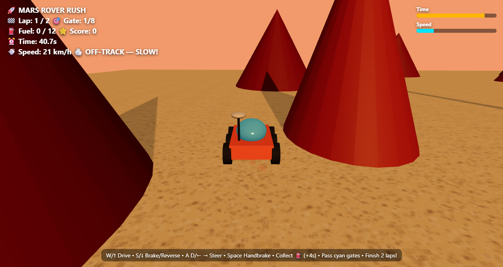 | 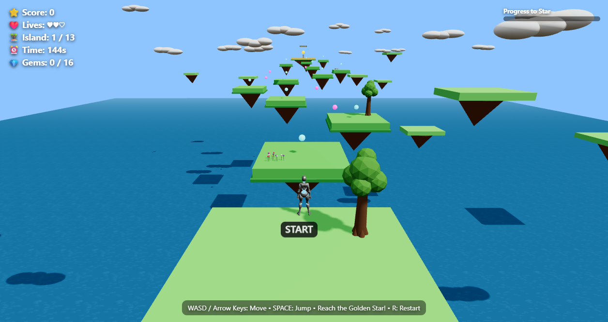 | 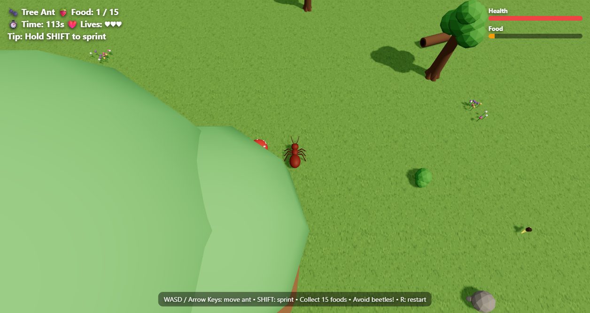 |

From the terminal: `npm run make -- "your idea"` (with the server running).

### The level designer: describe a place, get a stealth level (Oct 29)

Start the server, then open http://localhost:3000/levels.html. Type the game you want, or press **Speak** and say it. Example: *"A prison escape: I must steal the warden's keycard and get out. Two guards and a robot."*
- **Places:** indoors (homes, museums, prisons, castles…) or outdoors (forest, garden), with trees, rocks, mushrooms and more.
- **Characters:** people, or creatures with walking legs: ants, spiders, bees, beetles, dogs, cats, mice and birds, in any colour. For things the kit doesn't have, the designer draws them from simple shapes. Anything it still can't show is listed on the page.
- **Speaking:** the page stops listening when you pause. Meta's speech-to-text model (`muse-voice-transcribe-1.0`) writes down your words, and the design starts at once.
- **Meta's Muse Spark designs the level:** rooms, doors, furniture, lights, hunters, the target and the story.
- **Code checks that it can be played.** Any problems go back to Muse Spark to fix.
- **The level appears in 3D,** with animated characters.

In the first tests, five ideas each became a playable level on the first try, taking 18–28 seconds and about 3 cents each. When asked for a racing game, the designer said this game can't do racing and made the closest stealth version instead.

From the terminal: `npm run design -- "your idea"`. Playing designed levels in 3D is the next step.

| Prison escape | Haunted mansion | "A car racing game", turned into a heist |
|---|---|---|
| 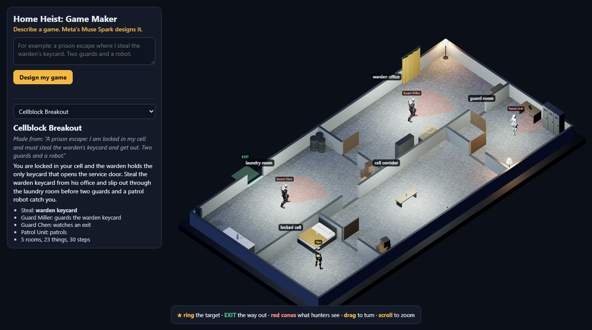 | 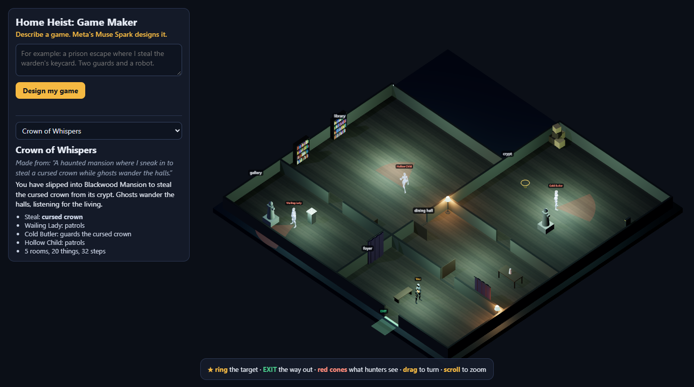 | 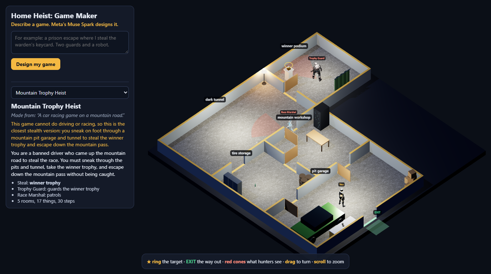 |

### The 3D game (prototype)

Start the server, then open http://localhost:3000/3d.html.

- **Characters:** animated soldiers as guards and a sneaking thief in a stealth suit.
- **Cameras:** a view behind the thief and an isometric overview. Press **V** to switch.
- **Moves:** WASD to move, Shift to run (noisy), C to sneak, T to throw the shoe, L for the lamp, F to hide in the closet, E to take the laptop.

In this prototype the guards still follow simple rules; Meta's models are not connected to the 3D game yet.

| Behind the thief | Overview |
|---|---|
| 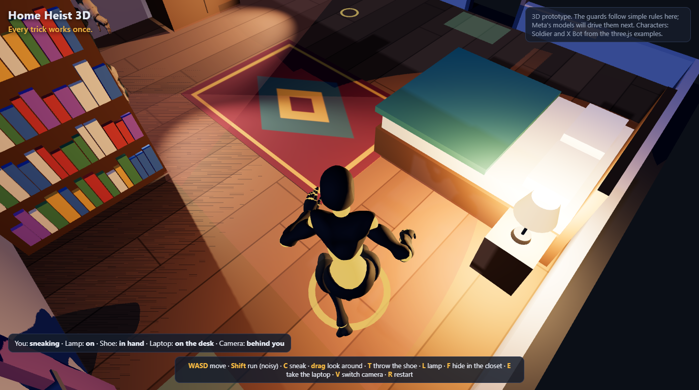 | 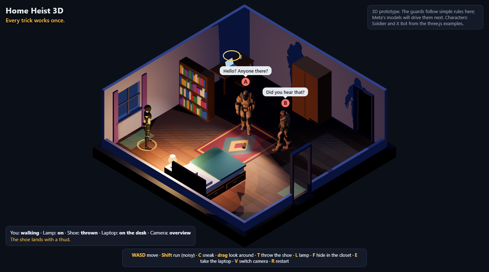 |

## Contents

- [Quick start](#quick-start)
- [What the demo shows](#what-the-demo-shows)
- [How to play](#how-to-play)
- [Use Meta's models](#use-metas-models)
- [How it works](#how-it-works)
- [Project structure](#project-structure)
- [Commands](#commands)
- [What works today](#what-works-today)
- [Documentation](#documentation)

## Quick start

You need [Node.js](https://nodejs.org) 24 or newer. Check with `node --version`.

```bash
npm install     # installs the type checker only; the game itself needs no packages
npm run demo    # plays four scripted rounds in the terminal
npm start       # starts the game; then open http://localhost:3000
```

## What the demo shows

`npm run demo` plays four rounds in the sample room and prints the whole story.

| Round | What the thief tries | Result | What the AI learns afterwards |
|---|---|---|---|
| 1 | Throw a shoe to lure the guards away, grab the laptop | Escaped | Guards: *a noise can be a trick, so the laptop guard never leaves the laptop* |
| 2 | The same shoe trick, and hide under the bed | Caught | Teacher: *the bed has storage drawers underneath, so nobody can hide there* |
| 3 | A new trick: switch off the only lamp and sneak in the dark | Escaped | Guards: *in the dark, the laptop guard stays and the other guard relights the lamp* |
| 4 | The darkness trick again, and hide under the bed again | Caught | Nothing new. The world model now refuses the bed. |

The full output is in [docs/BUILD_LOG.md](docs/BUILD_LOG.md#step-9-the-scripted-demo).

## How to play

- **Goal:** take the ★ laptop and leave through an **EXIT**: the window or the door.
- **Guards:** Guard A protects the laptop at the desk. Guard B watches the door.
- **Danger:** red zones are where a guard can see you. If a guard ends a step in your zone and you are not hiding, you are caught.
- **Each step:** click a highlighted zone to move, or use the buttons (take, hide, switch, throw, wait). You can also type any action, such as *throw the shoe at the bathroom door*.
- **Everyone acts at the same time.**
- **Noise travels:** a noise of loudness 1, 2 or 3 is heard up to that many zones away.
- **The lamp is the only light.** In the dark, guards only see their own zone.
- **After each round,** read the notebooks at the bottom of the page, then try a new trick.

The offline stand-ins only understand simple typed actions. Meta's world model is meant to handle anything you type.

## Use Meta's models

1. Claim the hackathon credits, then create a key in the Meta Model API dashboard.
2. Copy `.env.example` to `.env` and paste the key after `MODEL_API_KEY=`. The `.env` file is ignored by git, so the key is never uploaded.
3. Run `npm run api:check`. It lists the models your key can use and makes one tiny test call, which costs a fraction of a cent.
4. Optional: run `npm run api:try` to watch one round on the real models. Add `-- 2` for two rounds that share a notebook. It shows the time, cost, guard choices and world changes for each step, and costs a few cents per round.
5. Run `npm start`. The header now says **Meta Model API** and shows how much has been spent.

Measured on Oct 28:
- **After you act, a step takes about 2–4 seconds** and costs about 1 cent. The guards decide while you are still choosing, which is why it's quick.
- The end-of-round review takes 17–35 seconds and costs about 4–5 cents.

| Role | Model | Job | Price per million tokens (in / out) |
|---|---|---|---|
| World model | `muse-spark-1.3` | Decides what happens each step | $1.25 / $4.25 |
| Guards | `muse-spark-1.3` | Choose the guards' actions from what they can see and hear | $1.25 / $4.25 |
| Reflector | `muse-spark-1.3` | Writes the guards' lessons after a round | $1.25 / $4.25 |
| Teacher | `muse-wonder-1.0` | Checks the world model against the real room after a round | $4.00 / $20.00 |
| Designer | `muse-spark-1.3` | Before a game: turns your words into a level | $1.25 / $4.25 |
| Voice | `muse-voice-transcribe-1.0` | Turns your spoken idea into words (the Speak button) | $0.18 per hour of audio |
| Game writer | `muse-wonder-1.0` | Writes a whole game as code from your words, and fixes errors the test finds | $4.00 / $20.00 |
| World model in games | `muse-spark-1.3` | While a made game runs: decides what happens when you type or say something | $1.25 / $4.25 |
| Character minds | `muse-spark-1.3` | Rivals, guards and animals in a made game choose their plans every few seconds | $1.25 / $4.25 |
| Round teacher | `muse-wonder-1.0` | After each round of a made game: writes lessons for the world and the characters | $4.00 / $20.00 |
| No Engine: engine | `muse-spark-1.3` | Invents a world from your words, keeps its facts and decides every move | $1.25 / $4.25 |
| No Engine: painter | `muse-image-1.0` | Paints every frame, changing the last one | $0.01 per image |
| No Engine: memory | `muse-wonder-1.0` | Between rounds: what the characters remember about you | $4.00 / $20.00 |

Prices are from Meta's pricing page on Oct 27, 2026. Any model can be changed in `.env`.

If a Meta call fails, the offline stand-in handles that one call and the story shows a warning, so the game never freezes.

## How it works

```
Each step
  You ──────┐
            ├──► World model ──► Checker ──────► Engine ─────────────► new world
  Guards ───┘    (decides what   (blocks          (searches, catches,  + what each guard
  (see only      happens)        impossible       escapes)             sees and hears
  their view)                    changes)

After each round
  Round log ──► Reflector ──► Guards' notebook   strategy, e.g. "noises can be tricks"
  Round log ──► Teacher ────► World lessons      facts, e.g. "no space under the bed"
```

- **The code enforces only a few hard rules.**
  - You move one zone at a time.
  - Objects never vanish.
  - A hiding spot holds only as many people as it really fits.
  - A guard in your zone catches you unless you are hidden.
  - You win by reaching an exit with the target.
- **The world model decides everything else:** what your actions cause, what makes noise, what breaks and what works.
- **Guards decide only from what each guard can see and hear,** never from where the thief really is. This is the same idea as the partial views in multi-agent world models such as Agora-2.

The full design is in [docs/DESIGN.md](docs/DESIGN.md).

## Project structure

```
├── public/                    Browser pages (HTML, CSS, plain JavaScript)
│   ├── paint.html, paint.js   No Engine: say any world and play it; Meta's AI decides and paints every frame
│   ├── make.html, make.js     Speak Any Game: say or type a game, play what the AI writes
│   ├── kit/kit.js             The game kit every written game runs on
│   ├── kit/live.js            Meta's AI inside the game: kit.world, kit.mind, the Enter box, lessons
│   ├── sandbox.js, play.html  The sealed frame games run in (and the bridge for its AI questions), and a page that plays one game
│   ├── levels.html, levels.js The level designer: type an idea, see a stealth level in 3D
│   ├── level-builder.js       Builds any designed level in 3D
│   ├── characters.js          Animated characters, dressed by look
│   ├── creatures.js           Ants, spiders, bees, dogs, cats, mice, birds… with walking legs
│   ├── voice.js               Records your voice and turns it into WAV for Meta's speech-to-text
│   ├── 3d.html, 3d.js         The 3D bedroom prototype
│   └── index.html, app.js     The 2D debug view of the AI
├── rooms/
│   └── sample-bedroom.json    Hand-made stand-in for a room built from a photo
├── scripts/playtest.mjs       Plays a page in headless Edge in real time and takes screenshots
├── src/
│   ├── paint/engine.ts        No Engine: the world model, the painter, memory between rounds, saved in data/painted/
│   ├── live/                  Meta's AI inside running games
│   │   ├── rules.ts           Checks every question a game sends, and builds the reply format from its changes
│   │   ├── live.ts            The world model, minds and round teacher, with a budget and a rate limit
│   │   └── lessons.ts         What each game's AI has learned, in data/worlds/
│   ├── make/                  Speak Any Game
│   │   ├── writer.ts          Muse Wonder's instructions and the kit reference
│   │   ├── maker.ts           Write, test, send errors back, fix
│   │   ├── tester.ts          Plays a new game in a hidden browser (browser.ts drives Edge)
│   │   └── games.ts           Saves games and their screenshots in data/games/
│   ├── design/                The level designer
│   │   ├── catalog.ts         The 50 kinds of things the 3D game can draw, what each can do, and the looks and styles
│   │   ├── check.ts           Checks a designed level can be built and played
│   │   ├── build.ts           Turns a design into a room file the engine plays
│   │   ├── designer.ts        Design, check, send problems back, try again
│   │   └── levels.ts          Saves levels in data/levels/
│   ├── ai/
│   │   ├── types.ts           The AI roles: world model, guards, reflector, teacher, designer
│   │   ├── offline.ts         Offline stand-ins (simple rules, no API key needed)
│   │   ├── meta.ts            Meta Model API versions of the four roles
│   │   └── index.ts           Picks Meta or offline, and falls back if a call fails
│   ├── game/
│   │   ├── types.ts           Shapes of the world data
│   │   ├── world.ts           Helpers: paths, sight, light, applying changes
│   │   ├── room.ts            Loads a room file and checks it for broken references
│   │   ├── checker.ts         The hard rules that block impossible changes
│   │   ├── perception.ts      What each guard sees and hears
│   │   ├── engine.ts          One step: check, apply, then searches, catches, escapes
│   │   └── session.ts         Rounds, the guards' working memory, the notebooks
│   ├── memory/notebook.ts     Lessons saved between rounds
│   ├── tools/
│   │   ├── check-api.ts       Tests your Meta API key
│   │   ├── try-meta.ts        Plays one round on the real Meta models, with time and cost
│   │   └── design.ts          Designs levels from your words in the terminal
│   ├── config.ts              Settings from .env, and model prices
│   ├── voice.ts               Checks a voice clip before it is sent to Meta
│   ├── server.ts              Local web server and JSON API
│   ├── view.ts                What the browser receives
│   ├── demo.ts                The scripted terminal demo
│   └── demo-script.ts         The four scripted rounds (the tests replay them too)
├── test/                      42 automated tests
└── docs/
    ├── DESIGN.md              The full plan
    ├── BUILD_LOG.md           Step-by-step record of what was built and how it was checked
    └── images/                Screenshots
```

Notebooks, round logs, designed levels, made games and their lessons are saved in `data/`, which git ignores. Use **Wipe memory** in the game to start over.

## Commands

| Command | What it does |
|---|---|
| `npm start` | Starts the game at http://localhost:3000. Set `PORT` to change the port. |
| `npm run demo` | Plays the four scripted rounds in the terminal |
| `npm test` | Runs the 42 automated tests |
| `npm run polyhaven` | Rebuilds the index of Poly Haven's game-ready models, surfaces and skies (`public/models/polyhaven.json`) |
| `npm run people` | Converts the realistic people from Microsoft Rocketbox into `public/models/people/` (the server must be running). `npm run people -- Chef_Female_01` converts only the people named. |
| `npm run typecheck` | Checks the TypeScript types |
| `npm run api:check` | Checks your Meta API key (needs `.env`) |
| `npm run api:try` | Plays round 1 on the real Meta models, with time and cost per step. `npm run api:try -- 2` plays two rounds. Needs `.env` and costs a few cents per round. |
| `npm run make -- "your idea"` | Has Muse Wonder write a whole game, tests it in a hidden Edge browser and fixes errors. The server must be running. About $0.10–0.20 per game. |
| `npm run design -- "your idea"` | Designs a level from your words and saves it to `data/levels/`. Several ideas in a row make several levels. With `.env` it uses Muse Spark (a few cents each); without it, the offline stand-in returns a built-in museum. |

## What works today

| Part | Status |
|---|---|
| Game rules, map and browser game | Works |
| Guards that learn from rounds they lose | Works with the offline stand-ins |
| Teacher that corrects the world model | Works with the offline stand-ins, which check a written list of room facts |
| Meta Model API for all four roles | Runs. On Oct 28, real rounds played with no errors. The guards wrote lessons, and the teacher caught the planted mistake. |
| Game maker: your words become a level (Muse Spark) | Works. On Oct 29, five ideas became playable levels on the first try and were built in 3D. |
| Speak your idea (Muse Voice Transcribe) | Works. Tested with a pretend microphone playing a spoken clip: the page listened, wrote down the words and designed a pirate-ship level by itself. Not yet tried with a real voice. |
| Meta's AI inside made games: world model, minds, learning | Works. On Nov 2, two games written from one sentence each (a museum heist, and the user's own spoken bike-racing idea) worked on the first version, with world changes and characters that think. A hand-made fox game showed the learning: the fox's lessons from round 1 changed its first move in round 2. Speaking during play is built but not yet tried with a real voice. |
| Playing designed levels in 3D, with Meta's guards | Next |
| Photo becomes a level (SAM 3.1 + Muse Spark) | Later. It will use the same level format as the game maker. |
| A picture of the scene every step (Muse Image) | Next |
| AI-against-AI training and the two charts | Next: Nov 1–2 |

**An honest note on the demo:** the offline stand-ins are hand-written rules. The learning you see in the demo is scripted behaviour, not real AI learning. It proves the whole loop works end to end: play, write lessons, use lessons, correct the world. The real test comes when Meta's models run it.

## Documentation

- [docs/DESIGN.md](docs/DESIGN.md): the full plan. It covers the scenario, the rules, the two learning loops, how learning is measured, the architecture, the data formats, the schedule, the budget and the risks.
- [docs/BUILD_LOG.md](docs/BUILD_LOG.md): a step-by-step record of what was built, in what order, why, and how each step was checked.
