# Build log

A step-by-step record of how Home Heist was built (from Oct 27, 2026): what was done, why, and how each step was checked.

Every result below comes from a real run. Nothing is invented.

| Step | What |
|---|---|
| [0](#step-0-starting-point-and-decisions) | Starting point and decisions |
| [1](#step-1-check-the-tools) | Check the tools |
| [2](#step-2-read-metas-api-docs) | Read Meta's API docs |
| [3](#step-3-set-up-the-project) | Set up the project |
| [4](#step-4-the-sample-room) | The sample room |
| [5](#step-5-the-game-core) | The game core |
| [6](#step-6-the-four-ai-roles-and-the-offline-stand-ins) | The four AI roles and the offline stand-ins |
| [7](#step-7-the-meta-model-api-version) | The Meta Model API version |
| [8](#step-8-memory-and-rounds) | Memory and rounds |
| [9](#step-9-the-scripted-demo) | The scripted demo |
| [10](#step-10-automated-tests) | Automated tests |
| [11](#step-11-web-server-and-browser-game) | Web server and browser game |
| [12](#step-12-check-the-server-through-its-api) | Check the server through its API |
| [13](#step-13-check-the-page-with-screenshots) | Check the page with screenshots |
| [14](#step-14-clean-up) | Clean up |
| [15](#step-15-first-run-with-the-real-meta-models) | First run with the real Meta models |
| [16](#step-16-fair-guards-faster-steps-strict-replies) | Fair guards, faster steps, strict replies |
| [17](#step-17-a-3d-look-test) | A 3D look test |
| [18](#step-18-real-animated-characters-and-two-cameras) | Real animated characters and two cameras |
| [19](#step-19-the-game-maker-describe-a-game-get-a-level) | The game maker: describe a game, get a level |
| [20](#step-20-speak-your-idea) | Speak your idea |
| [21](#step-21-the-tree-ant-test-outdoor-worlds-and-creatures) | The "tree ant" test: outdoor worlds and creatures |
| [22](#step-22-speak-any-game-the-ai-writes-the-game-itself) | Speak any game: the AI writes the game itself |
| [23](#step-23-real-graphics-lighting-real-3d-models-and-a-reviewer-that-looks) | Real graphics: lighting, real 3D models, and a reviewer that looks |
| [24](#step-24-the-realism-test-real-sky-scanned-surfaces-a-detailed-f1-car) | The realism test: real sky, scanned surfaces, a detailed F1 car |
| [25](#step-25-metas-ai-inside-every-game-world-model-minds-and-learning) | Meta's AI inside every game: world model, minds and learning |
| [26](#step-26-no-engine-a-game-with-no-game-code) | No Engine: a game with no game code |
| [27](#step-27-rewind-a-world-model-that-runs-time-backwards) | Rewind: a world model that runs time backwards |
| [28](#step-28-real-scanned-models-surfaces-and-skies-in-every-game-poly-haven) | Real scanned models, surfaces and skies in every game (Poly Haven) |
| [29](#step-29-real-people-in-every-game-microsoft-rocketbox) | Real people in every game (Microsoft Rocketbox) |
| [30](#step-30-a-new-studio-page-designed-with-react-bits-fancy-components-and-cobe) | A new studio page, designed with React Bits, Fancy Components and COBE |
| [Final](#final-check) | Final check, and how to repeat it |
| [Next](#not-done-yet) | Not done yet |

---

## Step 0: Starting point and decisions

**Starting point:** the repository had one commit ("Initial commit") and a one-line README.

**Decisions made while planning, before any code:**

1. **Goal:** for the Meta Global AI Developer Hackathon, build a game that uses a *world model*, inspired by Odyssey's Agora-2, a multi-agent world model that acts as a learned game engine.
2. **What Meta's models can do:** Muse Wonder turned out to be a frontier language model, not a model that generates video. No Meta model renders interactive video. So the world model here is a language model (Muse Spark) that decides what happens and returns state changes. Drawing the scene is a separate job.
3. **Concept:** "Home Heist":
   - a heist in a world built from a photo of a real place
   - guards that learn the player's tricks
   - a teacher that corrects the world model
   - This follows the "agents and world model improve together" idea from Odyssey's PROWL research.
4. **Plan:** the scenario, schedule, budget and risks were agreed. They are written up in [DESIGN.md](DESIGN.md).
5. **Request:** build a small demo with properly structured files, and document everything, including this step-by-step log.

## Step 1: Check the tools

```bash
node --version; npm --version; git --version
```

Result: `v24.14.0`, `11.9.0`, `git version 2.52.0.windows.1`.

**Decision:** Node 24 can run TypeScript files directly by stripping the types, so the project needs **no build step**.
- The code uses only TypeScript syntax that can simply be erased: no enums and no namespaces.
- The `erasableSyntaxOnly` setting in `tsconfig.json` enforces this.

## Step 2: Read Meta's API docs

Pages read on dev.meta.ai:

| Page | What it settled |
|---|---|
| `docs/models.md` | Model ids: `muse-spark-1.3`, `muse-wonder-1.0`, `muse-image-1.0`, `sam-3.1`, `muse-voice-transcribe-1.0`. Base URL `https://api.meta.ai/v1`. Works with the OpenAI SDK. |
| `docs/pricing-rate-limits` | Prices: the table in `src/config.ts`. Rate limits: 3,000 requests per minute for Spark and Wonder; 150 for contributor mode and for Muse Image. |
| `docs/protocols/chat-completions` | `POST /chat/completions`, `reasoning_effort`, `max_completion_tokens`. The reply is in `choices[0].message.content`. `stop`, `n > 1` and `logprobs` are not supported. |
| `docs/structured-output` | `response_format: { type: "json_schema", json_schema: { name, schema, strict } }`. With `strict: true`, every object must set `additionalProperties: false` and list every key as required. |
| `docs/reasoning` | `reasoning_effort` accepts `none` to `max`, but `"none"` returns an error on Muse models. Reasoning tokens are billed as output. |

**Choice:** the code uses non-strict JSON schemas (`strict` left out). This avoids the stricter schema rules, and the checker validates everything anyway.

**Still unconfirmed:**
- whether `usage.completion_tokens` already includes the reasoning tokens
- whether cached tokens appear as `usage.prompt_tokens_details.cached_tokens`

Both affect only the cost estimate.

## Step 3: Set up the project

Files created:
- `package.json`: scripts `start`, `demo`, `test`, `typecheck`, `api:check`
- `tsconfig.json`: type-checking only, strict
- `.gitignore`: `node_modules/`, `data/`, `.env`
- `.env.example`: shows where the API key goes

```bash
npm install --save-dev typescript @types/node
```

Result: `added 4 packages ... found 0 vulnerabilities`. TypeScript version: `7.0.2`.

The game itself has **zero runtime dependencies**. It uses only Node's built-in modules and `fetch`.

## Step 4: The sample room

File: `rooms/sample-bedroom.json`. This is a hand-made stand-in for a room the world builder will later make from a photo. The scene is a bedroom office at night, and the thief climbed in through the window.

| Zone | Exit | Neighbors (one step away) | Can see (when lit) |
|---|---|---|---|
| the window | yes | rug, bed, desk | rug, bed |
| the desk | | rug, closet, window | rug, closet |
| the rug | | window, desk, bed, closet, door | window, desk, bed, closet, door |
| the bed | | rug, window, door | window, rug, door |
| the closet | | desk, rug, bathroom door | desk, rug, bathroom door |
| the door | yes | rug, bed, bathroom door | rug, bed, bathroom door |
| the bathroom door | | closet, door | closet, door |

- A tall **bookshelf** blocks the view between the window and the desk. That is why the thief can start unseen and walk around it to the desk.
- **Objects:**
  - laptop (the ★ target), on the desk
  - coffee mug, on the desk; breaks loudly
  - shoe, held by the thief
  - pillow, on the bed; soft
  - bedside lamp, the only light
  - closet and curtains, each hides one person
  - bed: see the deliberate mistake below
- **Characters:**
  - You, at the window
  - Guard A, at the desk, protecting the laptop
  - Guard B, at the door, watching the exit
- **A deliberate mistake:** the room file says one person can hide under the bed (`hideCapacity: 1`), but its fact list says the bed has storage drawers underneath. This copies the kind of error a world builder could make from a photo, and gives the teacher something real to catch.

## Step 5: The game core

| File | What it does |
|---|---|
| `src/game/types.ts` | Shapes of all world data: zones, objects, characters, actions, changes, observations |
| `src/game/world.ts` | Helpers: shortest paths, distances, sight, light, applying a change |
| `src/game/room.ts` | Loads a room file and lists every broken reference. Neighbors and sight must go both ways. |
| `src/game/checker.ts` | The hard rules. Each change the world model proposes is accepted or blocked with a reason. |
| `src/game/perception.ts` | What each guard sees and hears after a step |
| `src/game/engine.ts` | One step: check, apply, then searches, catches, escapes and the step limit |

Key decisions:
- **Who decides what:** the world model only *proposes* changes. Plain code decides whether they are possible, and settles catches and escapes. This keeps the game fair and makes world-model mistakes measurable as "blocked changes".
- **Simultaneous turns:** everyone acts at the same time, and guards act on what they noticed at the end of the previous step.
- **Repeatable paths:** the shortest path follows each zone's neighbor order, so the same actions always give the same result. This is what makes the tests possible.

Check: `npx tsc --noEmit` reported no errors.

## Step 6: The four AI roles and the offline stand-ins

`src/ai/types.ts` defines four roles, so the offline and Meta versions can be swapped:

| Role | Job |
|---|---|
| World model | Decides what happens when everyone acts |
| Guard brain | Chooses the guards' actions from what they can see and hear, and from their lessons |
| Reflector | After a round, writes new strategy lessons for the guards |
| Teacher | After a round, compares the world model's results with the real place and reports mistakes |

`src/ai/offline.ts` holds simple rule-based stand-ins, so the game works with no API key:
- **World model:**
  - reads typed text with keyword rules; for example, "hide under the bed" becomes a hide action on the bed
  - throws land up to 3 zones away; the mug shatters at loudness 3; switching the lamp makes a quiet click
  - follows "forbid" world lessons
- **Guards:**
  - chase the thief if they see them, investigate noises, search spots they saw the thief hide in, and relight the lamp in the dark
  - lessons change *which* guard reacts:
    - "distraction": the laptop guard ignores noises
    - "darkness": the laptop guard stays and the other guard relights the lamp
- **Reflector:** after a lost round, replays the accepted changes and spots three tricks: a thrown object, the light switched off, and hiding.
- **Teacher:** checks each accepted hide change against facts marked `forbids: "hide"`.

## Step 7: The Meta Model API version

| File | What it does |
|---|---|
| `src/ai/meta.ts` | A small client for `POST /chat/completions` with JSON-schema replies, plus all four roles. It retries on 429 and 5xx errors, times out after 90 s, and adds up the cost of each call. |
| `src/ai/index.ts` | Uses Meta when `MODEL_API_KEY` is set, otherwise offline. If a Meta call fails, the offline stand-in handles that call and a warning appears in the story. |
| `src/tools/check-api.ts` | `npm run api:check` lists the models your key can use and makes one tiny test call. |

What each role sends:
- **World model:** the room, the layout, the objects, the characters, the world lessons and everyone's actions.
- **Guards:** only what the guards could know: the layout, the visible objects, each guard's observation, its memory and its plan. The thief's real position is never sent.
- **Teacher:** the room facts plus the round's steps.

**Not run yet:** this needs an API key. It is written from the docs in step 2 and passes the type checker, but no real call has been made.

## Step 8: Memory and rounds

| File | What it does |
|---|---|
| `src/memory/notebook.ts` | The guards' lessons, the world lessons and the round history, saved as one JSON file per room. Duplicate lessons are skipped. |
| `src/game/session.ts` | One player's game. `act()` plays a step: guards decide, the world model resolves, the engine applies. When a round ends, the reflector and the teacher run and the notebook is saved, together with a full log of the round. |

## Step 9: The scripted demo

| File | What it does |
|---|---|
| `src/demo-script.ts` | Four scripted rounds. The tests replay them too. |
| `src/demo.ts` | Plays them with the offline stand-ins and prints the story |

**First run** (`npm run demo`): all four rounds ended as designed: escaped, caught, escaped, caught.

**Problem found:** when a guard followed a lesson and *stayed* at its post, the story showed nothing. Waiting guards get no line, so the learning was invisible.

**Fix:** a guard that holds its post because of a lesson now says so: *"Guard A stays at the desk, because the notebook says noises can be tricks."*

**Second run:** these lines now appear in rounds 2, 3 and 4. Full output of the final run:

<details>
<summary>Full output of <code>npm run demo</code></summary>

```text
HOME HEIST · scripted demo with the offline stand-in models
Room: Sample bedroom office. Goal: take the laptop and leave by an exit.
Guard A protects the laptop at the desk. Guard B watches the door.

=== Round 1: The shoe trick ===
Throw a shoe to lure the guards away, grab the laptop, and leave by the window.

  Step 1  > throw the shoe at the bathroom door
           You throw the shoe. It lands by the bathroom door with a thud.

  Step 2  > wait
           You wait and listen.
           Guard A walks to the closet.
           Guard B walks to the bathroom door.

  Step 3  > move to the desk
           You move to the desk.
           Guard A walks to the bathroom door.
           Guard B looks around the bathroom door.

  Step 4  > take the laptop
           You grab the laptop.
           Guard A looks around the bathroom door.
           Guard B walks to the door.

  Step 5  > move to the window
           You move to the window.
           Guard A walks to the closet.
           You slip out by the window with the laptop. You escaped!

  Result: ESCAPED after 5 steps.
  The guards wrote in their notebook:
    - The thief threw the shoe at the bathroom door to pull us away. A noise can be a trick: the guard protecting the laptop never leaves it to check a noise.

=== Round 2: The same trick again ===
Try the shoe trick a second time. Also test the world model by hiding under the bed.

  Step 1  > throw the shoe at the bathroom door
           You throw the shoe. It lands by the bathroom door with a thud.

  Step 2  > move to the bed
           You move to the bed.
           Guard A stays at the desk, because the notebook says noises can be tricks.
           Guard B walks to the bathroom door.

  Step 3  > hide under the bed
           You squeeze under the bed and keep still.
           Guard B looks around the bathroom door.

  Step 4  > move to the window
           You slip out from under the bed and move to the window.
           Guard B walks to the door.

  Step 5  > move to the desk
           You move to the desk.
           Guard A catches you at the desk!

  Result: CAUGHT after 5 steps.
  The guards learned nothing new.
  The teacher found a world-model mistake and saved a world lesson:
    - Step 3: The world model let someone hide under the bed, but in the real room: The bed has storage drawers underneath, so there is no space to hide under it.

=== Round 3: A new trick: darkness ===
Lure one guard with the shoe, switch off the only lamp, and sneak to the laptop in the dark.

  Step 1  > throw the shoe at the bathroom door
           You throw the shoe. It lands by the bathroom door with a thud.

  Step 2  > move to the bed
           You move to the bed.
           Guard A stays at the desk, because the notebook says noises can be tricks.
           Guard B walks to the bathroom door.

  Step 3  > turn off the lamp
           You switch the bedside lamp off. The room goes dark.
           Guard B looks around the bathroom door.

  Step 4  > move to the window
           You move to the window.
           Guard A walks to the rug.
           Guard B walks to the door.

  Step 5  > move to the desk
           You move to the desk.
           Guard A walks to the bed.

  Step 6  > take the laptop
           You grab the laptop.
           Guard A switches the bedside lamp back on.

  Step 7  > move to the window
           You move to the window.
           Guard A walks to the rug.
           Guard B walks to the bed.
           You slip out by the window with the laptop. You escaped!

  Result: ESCAPED after 7 steps.
  The guards wrote in their notebook:
    - The thief switched off the bedside lamp and moved in the dark. When the room goes dark, the guard protecting the laptop stays put and the other guard turns the light back on.

=== Round 4: Both tricks again ===
Repeat the darkness trick, and try hiding under the bed one more time.

  Step 1  > throw the shoe at the bathroom door
           You throw the shoe. It lands by the bathroom door with a thud.

  Step 2  > move to the bed
           You move to the bed.
           Guard A stays at the desk, because the notebook says noises can be tricks.
           Guard B walks to the bathroom door.

  Step 3  > hide under the bed
           You try to hide under the bed, but you can't. The bed has storage drawers underneath, so there is no space to hide under it.
           Guard B looks around the bathroom door.

  Step 4  > turn off the lamp
           You switch the bedside lamp off. The room goes dark.
           Guard B walks to the door.

  Step 5  > move to the window
           You move to the window.
           Guard A stays at the desk, because the notebook says the dark can be a trick.
           Guard B walks to the bed.

  Step 6  > move to the desk
           You move to the desk.
           Guard B switches the bedside lamp back on.
           Guard A catches you at the desk!

  Result: CAUGHT after 6 steps.
  The guards learned nothing new.

=== Summary ===
Round  Result    Steps  World-model mistakes found  New guard lessons
1      ESCAPED   5      0                           1
2      CAUGHT    5      1                           0
3      ESCAPED   7      0                           1
4      CAUGHT    6      0                           0
```

</details>

## Step 10: Automated tests

Tests use Node's built-in test runner, so no extra packages are needed. Run them with `npm test`.

| File | What it checks |
|---|---|
| `test/world.test.ts` | The sample room has no broken references; validation catches a one-way path; the bookshelf blocks the view; darkness limits sight; paths and distances; hearing range; spotting and seeing someone hide |
| `test/checker.test.ts` | Moves only to neighbors, once per step; unknown ids are blocked; hiding rules; pick-up and throw range; switches; blocked changes are reported and not applied; catching, and finding a hidden thief by searching |
| `test/offline-ai.test.ts` | Typed actions are understood; the world model follows a "forbid" lesson; a thrown mug breaks at loudness 3 |
| `test/demo-rounds.test.ts` | The whole four-round script (results, steps, lessons and the refused hiding spot), and the round-numbering rule (added in step 13) |

Result at this point: **18 tests, 18 passed, 0 failed.**

## Step 11: Web server and browser game

| File | What it does |
|---|---|
| `src/server.ts` | Serves `public/` and a JSON API (`GET /api/state`, `POST /api/action`, `/api/round`, `/api/reset`) |
| `src/view.ts` | Builds what the browser receives: the map, the thief's options, the story, the notebooks, the report and the cost |
| `public/index.html`, `style.css`, `app.js` | The game page |

What the page shows:
- an SVG map: zones, paths, exits, red zones where a guard can see you, and highlighted zones you can click to move
- the story log
- action buttons and a box for typing any action
- an end-of-round report
- the two notebooks and a table of finished rounds

Safety measures:
- The server listens only on `127.0.0.1`, so it is not reachable from other computers.
- Requests for files outside `public/` are refused.
- Request bodies are capped at 10 KB.
- Only known action fields are accepted.
- The page puts all story text in with `textContent`, so text from an AI can never run as code in the page.

A typo found while reviewing the stylesheet (`max height` instead of `max-height`) was fixed before testing.

## Step 12: Check the server through its API

The server was started on a spare port (`PORT=3123 npm start`) and played with `curl`:

| Check | Result |
|---|---|
| `GET /`, `/app.js`, `/style.css` | `200`, with the right content types |
| `GET /../package.json` and `GET /%2e%2e/package.json` (path traversal) | `404`, refused |
| `POST /api/action` with `{"kind":"fly"}` | `400`, with a helpful message |
| Round 1 played step by step (throw, wait, desk, take, window) | `escaped` at step 5, the same as the scripted demo |
| An action after the round ended | `409`: "This round is over. Start the next round." |
| `GET /api/state` after the round | report `escaped`; guard lessons: `distraction`; 1 history row |
| A typed action: *"throw my shoe at the bathroom door"* | Understood as a throw at the bathroom door |
| Round 2, step 2 | "Guard A stays at the desk, because the notebook says noises can be tricks." |
| Saved files | `data/notebooks/sample-bedroom.json` and a round log in `data/logs/` |

## Step 13: Check the page with screenshots

The page was photographed with Microsoft Edge in headless mode (`msedge --headless --screenshot`), while steps were played through the API.

**Problem found:** the header showed "Round 3", and the round table listed rounds 1 and 3. Restarting an unfinished round skipped a round number.

**Fix:**
- An unfinished round now restarts under the same number. A finished round is followed by the next one (`Session.startRound`).
- The restart button now reads "Restart round" during a round and "Next round" after one.
- A test was added: 19 tests, 19 passed.

The screenshots were then retaken with the fixed code and a fresh notebook:

| Mid-round (round 2, step 2) | In the dark | Round report |
|---|---|---|
| 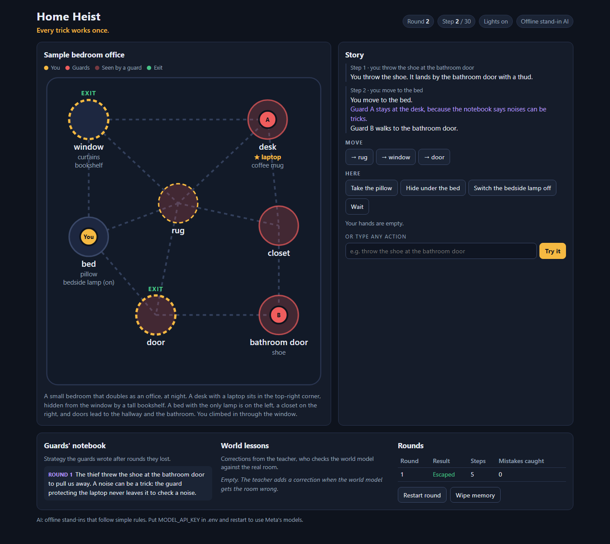 | 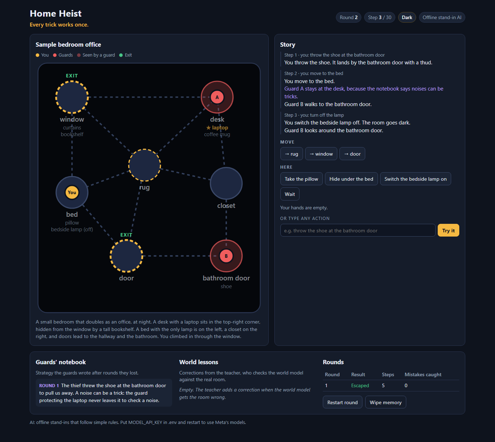 | 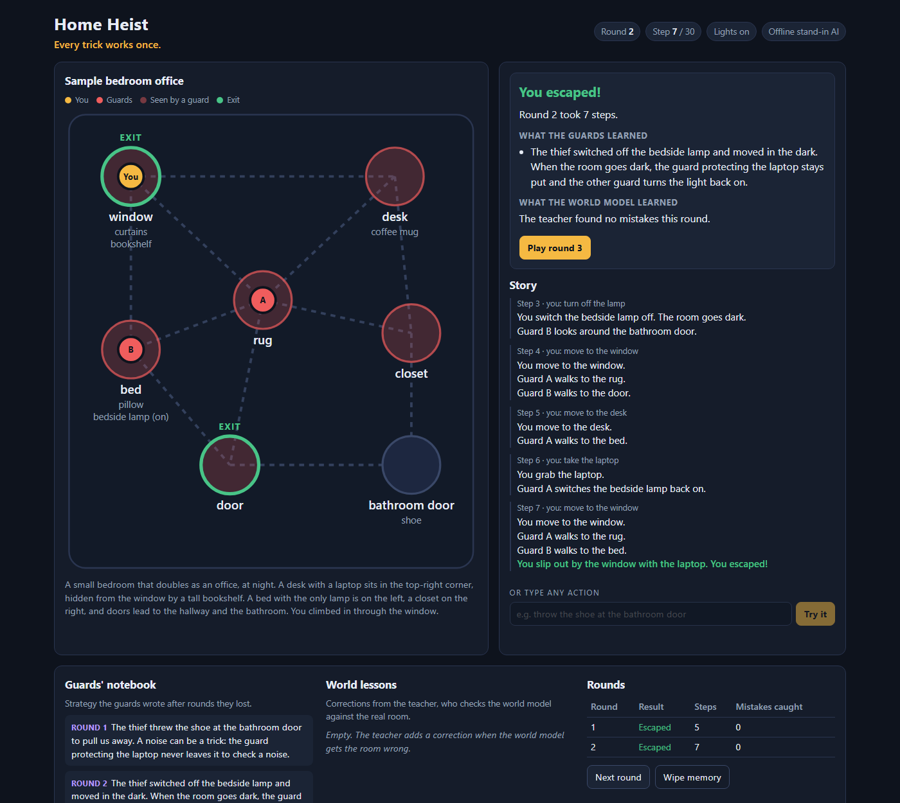 |

## Step 14: Clean up

- The `data/` folder held only files from the test runs above, so it was deleted. You start with empty notebooks.
- **Nothing has been committed to git yet.** All new files are still uncommitted.

## Step 15: First run with the real Meta models

After the API key was added to `.env`, the first real calls were made (Oct 28).

**`.env` check:** the key was checked without printing it. It is 48 characters, with no quotes or spaces, and git ignores the file (`git check-ignore .env`).

**Key check** (`npm run api:check`):

```text
Your key works. 9 models are available to you.
  world      muse-spark-1.3     available
  guards     muse-spark-1.3     available
  reflector  muse-spark-1.3     available
  teacher    muse-wonder-1.0    available
Test call to muse-spark-1.3 replied {"ok":true}. Cost: about $0.00030.
```

This confirms the request format from step 2: the `developer` role, `reasoning_effort` and JSON-schema replies all work.

**New tool:** `src/tools/try-meta.ts` (`npm run api:try`). It plays round 1 of the script on the real models and prints, for every step:
- the time and the cost
- what each guard chose
- the story
- the accepted changes and the noises

**Two runs:**

| | Run 1 | Run 2 |
|---|---|---|
| Result | Caught at step 2 | Caught at step 3 |
| Seconds per normal step | 9.1 | 7.1 and 8.9 |
| Last step, including the end-of-round review | 20.1 s | 20.6 s |
| Calls | 6 | 8 |
| Cost | $0.042 | $0.066 |
| Failed calls or blocked changes | none | none |

<details>
<summary>Output of run 2</summary>

```text
Playing "The shoe trick" with the Meta models: world = muse-spark-1.3, guards = muse-spark-1.3, reflector = muse-spark-1.3, teacher = muse-wonder-1.0

Step 1  > throw the shoe at the bathroom door   (7.1 s, $0.0072)
  [guardA chose: wait]
  [guardB chose: wait]
  You hurl your shoe toward the bathroom door.
  changes: shoe lands at bathroom
  noises: shoe thuds in the bathroom at bathroom (loudness 2)

Step 2  > wait   (8.9 s, $0.0103)
  [guardA chose: wait]
  [guardB chose: move to the rug]
  You wait quietly by the window.
  Guard B moves to the rug.
  changes: guardB → rug
  noises: none

Step 3  > move to the desk   (20.6 s, $0.0482, including the end-of-round review)
  [guardA chose: wait]
  [guardB chose: wait]
  You slip from the window to the desk.
  Guard A catches you at the desk!
  changes: thief → desk
  noises: none

Result: caught after 3 steps.

Total: 8 calls, $0.0657
  muse-spark-1.3: 7 calls, 7147 tokens in (241 cached), 4716 out, $0.0287
  muse-wonder-1.0: 1 calls, 688 tokens in (500 cached), 1805 out, $0.0370
```

</details>

**What the runs showed:**

1. **The whole Meta pipeline works.** Every reply was valid, and every change passed the checker. For the shoe, the world model proposed exactly what the rules need: the shoe lands at the bathroom door, with a loudness-2 noise.
2. **The real guards are cautious from round 1.**
   - In run 2, Guard A heard the noise and still stayed at the laptop, without any lesson.
   - In run 1, Guard B patrolled to the rug, saw the thief at the window, and made the catch.
   - The script was written for the offline guards, so failing here is expected.
   - **Cause:** the guard instructions in `src/ai/meta.ts` say *"Never leave the target and the exits unguarded at the same time."* That sentence hands the guards the distraction lesson before they play, which leaves little to learn. It should be removed if the learning is to be measured (Next).
3. **Speed:** a step takes about 7–9 seconds, because two calls run one after the other: guards, then the world model. The end-of-round review adds about 12 seconds.
4. **Cost:**
   - about 1 cent per step (Muse Spark)
   - about 4 cents per end-of-round review, mostly Muse Wonder
   - so about 30–35 cents for a full 30-step round
5. **Usage fields:**
   - Cached tokens are reported: 241 and 500 cached tokens appeared.
   - `completion_tokens` was about 700–1,000 per call, although each JSON reply is short. So it very likely includes the reasoning tokens, which means the cost tracking is right.
   - To be sure, compare the total with the Billing page.

**Total spent in this step,** by the tool's own tracking: about **$0.11** ($0.0003 + $0.042 + $0.066).

## Step 16: Fair guards, faster steps, strict replies

The user approved the two fixes proposed in step 15. A third fix came out of testing them.

**Fix 1: guards start without the lesson** (`src/ai/meta.ts`):
- The sentence *"Never leave the target and the exits unguarded at the same time"* was removed.
- In its place, the guards are told to act like ordinary guards: go after a thief they can see, and check noises they hear. Lessons override these habits.

**Fix 2: guards decide while the player is still choosing** (`src/game/session.ts`):
- The guards' next actions depend only on what they noticed so far, so `#prepareGuards()` starts that call as soon as a step ends (and when a round starts).
- When the player acts, only the world-model call is left.
- `guardsReady()` lets the tools wait the way a thinking player would.
- The page now shows *"The world model is deciding what happens…"* while a step is running.

**Testing fixes 1 and 2:** `npm run api:try -- 2`, a new option that plays two rounds and keeps the notebook between them.
- Speed improved: you now wait 1.5–6.7 seconds after acting, down from 7–9.
- It also exposed a hidden bug. In round 2, step 5, the story said *"You slip from the window to the desk"*, but nobody moved.

**Finding the bug:** unreadable changes used to be dropped silently. They are now reported as blocked changes (the `unreadable` field of an outcome), so they count as world-model mistakes. The next run showed the cause: the model sometimes **garbled the field names** in its JSON:

```text
Checker blocked a change: the world model sent a change the game could not read: {"op":"place","object~~endsoap":"shoe","zone~~~endsoap":"bathroom"}.
Checker blocked a change: the world model sent a change the game could not read: {"op":"move","actor якої":"thief","toй":"desk"}.
```

**Fix 3: strict JSON mode** (`src/ai/meta.ts`):
- All replies now use `strict: true`, which constrains the key names as well as the shape.
- Strict mode needs every key to be required and no extra keys allowed, so the helper `strictObject()` builds schemas that way.
- The world model's changes are now separate lists (`moves`, `hides`, `unhides`, `pickUps`, `places`, `sets`). Every field in them is required, so nothing is optional and nothing has to be guessed.
- The checker reads the lists in a fixed order: leave hiding, move, pick up, land, hide, switch or break.

**Result after all three fixes** (`npm run api:try -- 2`):

| | Round 1 (shoe trick) | Round 2 (shoe trick + hide under the bed) |
|---|---|---|
| Result | Caught at step 3 | Caught at step 4: Guard B searched under the bed |
| Unreadable or blocked changes | none | none |
| Wait after acting | 2.3–2.5 s | 2.0–4.0 s |
| End-of-round review | the last step took 37 s in total | the last step took 21 s in total |
| Guard lesson written | "If the shoe lands in the bathroom making noise, do not move to the bathroom to investigate; stay on post covering the desk and window." | "If you move to the bed, search under the bed on your next turn instead of just waiting or walking past." |
| Teacher (Muse Wonder) | no mistakes | **Caught the bed mistake:** "The thief successfully hides under the bed, but the bed has storage drawers underneath and therefore has no space for a person to fit." |
| World lesson saved | none | "Furniture with storage drawers or a solid base underneath has no open cavity, so a person cannot hide under it; hiding actions must check for actual open space beneath the object." |
| Cost | $0.165 for both rounds | |

**What this shows:**
- **Both learning loops now run on Meta's models.**
  - The guards wrote a lesson from what happened.
  - The teacher compared the world model with the real room's facts and found the planted mistake on its own.
  - Its lesson is a general rule, not only about this bed.
- **The real guards are still sensible without lessons.** Even with fix 1, Guard A stayed at the laptop and only Guard B checked the noise. Splitting up like that is what any two guards would do. So the shoe trick is not a good trick for showing learning on real models. The hiding trick and the darkness trick are better candidates.
- **The end-of-round review is slow,** 17–35 seconds, mostly Muse Wonder. It could run in the background while the report shows "the guards are writing in their notebook" (Next).

**Spent on Meta calls so far,** by the tools' own tracking: about **$0.53** in total.

## Step 17: A 3D look test

**Feedback:** after seeing the browser game, the user said this was not the game they meant. They want a **3D indie game** that looks and plays like Agora-2, not a flat map with text. The plan had described "step by step, like a board game", but no picture of the game was shown before building. That was the mistake. From now on, the look is shown first.

**What was built:** a 3D version of the same room, as a look test (`public/3d.html`, `public/3d.js`), served by the same server at http://localhost:3000/3d.html.
- **Engine:** three.js 0.170.0, loaded from jsDelivr.
- **Camera:** isometric, from the south-west, like Diablo II, which is the game Agora-2 learned from.
- **The room:**
  - the walls toward the camera are cut low, so you can see inside
  - moonlight comes through the window
  - furniture: bookshelf, desk and laptop, bed with drawers, nightstand and lamp, closet, rug
  - the bathroom doorway and the main door
- **Light:** the bedside lamp is a real light, and switching it off makes the room dark.
- **Guards:**
  - carry flashlights and show red vision fans on the floor
  - see only within their cone; walls, the bookshelf and the closet block their view
  - see much less far in the dark
  - have a suspicion meter, and chase the thief once it fills
- **Thief:**
  - click to walk
  - **T** throws the shoe, which flies in an arc and makes a noise ring; guards within hearing go to check
  - **L** switches the lamp
  - **E** takes the laptop
  - reaching an exit with the laptop wins

**Not connected yet:** in this look test the guards follow simple rules. Meta's models are not wired in. The plan is that the 3D engine draws the world and moves everyone smoothly, while Meta's models decide what actions cause and what the guards do every few seconds.

**Honest limit, again:** the pixels come from a 3D engine, not from a neural network as in Agora-2. None of Meta's models can draw video.

**Checks:**
- `node --check public/3d.js` passed.
- Headless Edge with software WebGL (`--use-angle=swiftshader`) rendered the page with no page errors.
- After the first screenshots, the lighting was evened out (the lamp was too strong, the floor too dark).

The screenshots from this step were replaced by the ones in step 18.

## Step 18: Real animated characters and two cameras

**Feedback:** the look test was too simple. The user wants a complex game with **proper characters and real motion**, and asked me to answer my own two questions (which camera, and whether to go 3D) by showing the options.

**Answers:**
- **Go 3D:** yes. 3D is now the main game.
- **Camera:** both views were built, and **V** switches between them. The view behind the thief shows the character and the animations best. The overview is the Agora-2 / Diablo II view.

**What was built** (`public/3d.js`):

- **Animated characters** (loaded at runtime from the three.js examples on jsDelivr; not stored in this repo):
  - **Guards:** `Soldier.glb`, a realistic soldier with idle, walk and run animations.
  - **Thief:** `Xbot.glb`, with idle, walk and run, plus an extra *sneak pose* layered on top. It is dressed as a dark stealth suit with glowing amber seams.
  - Animations blend smoothly and play at the speed the character actually moves, so feet don't slide.
- **Cameras:**
  - **Behind the thief:**
    - drag to look around, and use the mouse wheel to zoom
    - the camera stays inside the room and looks down more when space is tight
    - walls between the camera and the thief turn see-through
  - **Overview:** isometric, with click-to-walk.
- **The thief's moves:**
  - WASD to move
  - **Shift** to run, which is fast but makes footsteps the guards can hear
  - **C** to sneak, which is slow but guards see you from much nearer
  - **T** throws the shoe
  - **L** switches the lamp
  - **F** hides in the closet. A guard who saw you go in comes to search it.
  - **E** takes the laptop
- **The guards' behaviour:**
  - A suspicion meter, shown as **?** and then **!** above their heads.
  - Speech bubbles: "What was that?", "Hm? Who's there?", "Hey! Stop right there!", "Who turned off the light?"
  - They investigate noises, search the closet, chase and catch.
  - In the dark, the nearest free guard goes and switches the lamp back on.
  - Their vision cones are cast as rays, so walls, the bookshelf and the closet cut them off.
- **Sound:** small synthesised effects for the thud, footsteps, the lamp click, the alarm and a win chime.

**A new testing tool:**
- **Why it was needed:** Edge's one-shot screenshot mode froze the clock right after the characters loaded, so the characters looked stuck in a T-pose.
- **What it does:** `scripts/playtest.mjs` drives headless Edge in real time through its DevTools interface. It can:
  - wait real seconds
  - hold and press keys
  - read values from the page (with `?debug=1`)
  - take screenshots
- **What it confirmed:** the animations really play. Running for 2.7 seconds gave `idle`/`Idle`/`Walk` at weight 1.

**Playtests run with it:**

| Test | Result |
|---|---|
| Walk straight into the room | Both guards spotted the thief ("?" then "!"), chased, and Guard A made the catch: "CAUGHT" |
| Press C, then walk | The thief crouches into the sneak pose |
| Throw the shoe into the middle of the room (overview) | Both guards left their posts to check ("Hello? Anyone there?" / "Did you hear that?") |
| Start with the lamp off | Guard B walks to the lamp: "Who turned off the light?" |

**Fixed during testing:**
- The camera swung outside the room, where big wall slabs blocked the view. It is now kept inside.
- There were jagged shadow spikes and stripes. The shadow bias settings were tuned; faint stripes remain in places.
- The vision cones went through walls. They are now cast as rays.

**Licence note:** Soldier and X Bot come from the three.js examples and are based on Mixamo. Check their licence before a public release, or switch to CC0 (public domain) character packs.

**Not done yet:**
- Meta's models are not connected to the 3D game.
- The level is still one room.
- More motions (pick up, throw, open doors, get caught) need an animation library.

| Behind the thief (sneaking) | Overview: guards check a noise | In the dark: a guard relights the lamp |
|---|---|---|
| 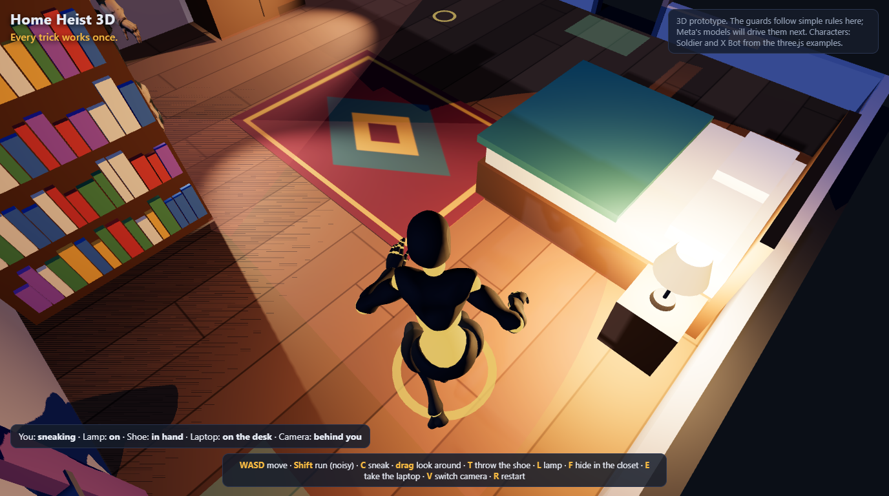 | 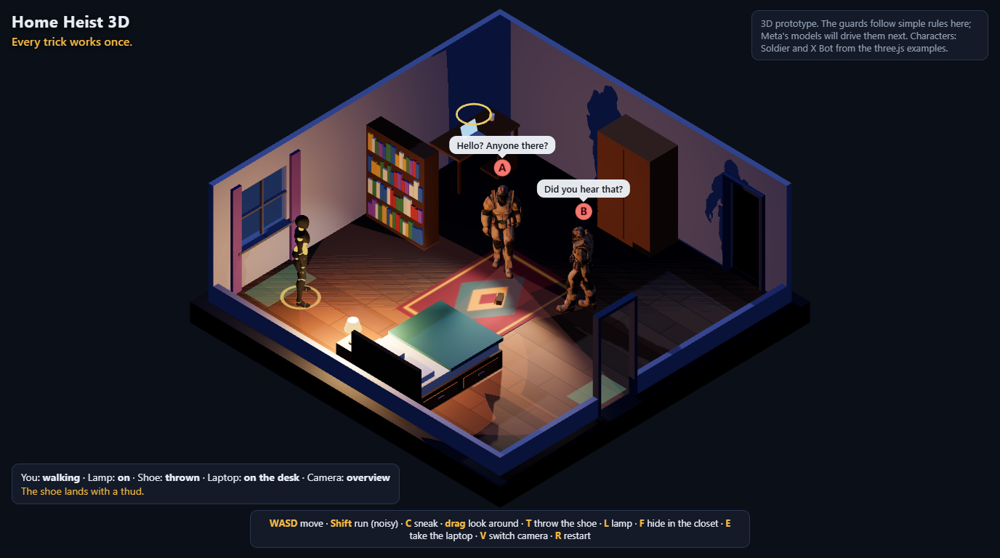 | 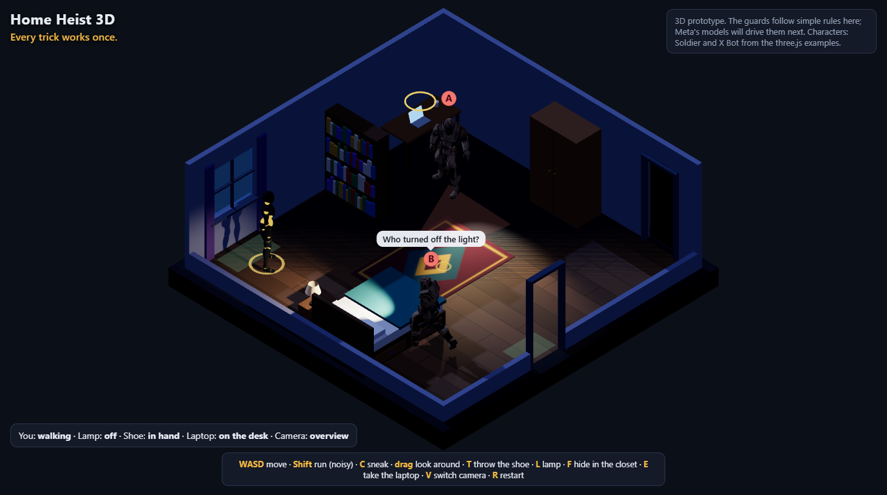 |

## Step 19: The game maker: describe a game, get a level

**Decision (Oct 29):** the user wants a model where "whatever I say, it will create a game". There are two kinds of "whatever I say":
- **during a game**, which the world model already handles
- **before a game**, which means designing a whole new game from the player's words

The user chose the second. The approved plan:
- Muse Spark designs a level from the words.
- Code checks that the level can be played.
- A 3D builder builds it.

**How it works:**

```
"A prison escape. Two guards and a robot."
  → Designer (Muse Spark)  writes the level as data: rooms on a grid, doors, objects, hunters, facts
  → Checker (code)         can it be built and played? Problems go back to the designer, up to 3 tries
  → Build (code)           turns it into a room file the existing engine plays; saved in data/levels/
  → 3D builder (browser)   walls, doorways, furniture, lights and animated characters
```

**What was built:**

| File | What it does |
|---|---|
| `src/design/catalog.ts` | The 40 kinds of things the 3D game can draw, and what each can do: hide in it, carry it, break it, switch it. The designer may only use these, so every level can be built. Also the looks and styles. |
| `src/design/types.ts` | The level format the designer writes |
| `src/design/check.ts` | The playability checks. Each problem is written as an instruction, because it is sent back to the designer. |
| `src/design/build.ts` | Turns a design into a room file. Each designed room becomes one zone. Guards can see through doorways but not through doors. |
| `src/design/designer.ts` | The loop: design, check, send the problems back, try again (3 tries at most) |
| `src/design/levels.ts` | Saves, lists and loads levels in `data/levels/` |
| `src/design/example.ts` | A hand-made museum level for the offline stand-in and the tests. One fact plants a mistake for the teacher, like the bed in the bedroom. |
| `src/ai/meta.ts` | `createMetaDesigner`: the instructions are built from the catalog. It uses a strict JSON reply, medium effort, up to 16,000 tokens and a 4-minute limit. |
| `src/tools/design.ts` | `npm run design -- "your idea"`: designs, prints a text plan of the building, and saves the level |
| `src/server.ts` | New: `GET /api/levels`, `GET /api/levels/<id>`, `GET /api/catalog`, `POST /api/design` |
| `public/levels.html`, `levels.js` | The game maker page: type an idea, see the level in 3D |
| `public/level-builder.js` | Builds any level in 3D, in the style it was given (10 styles) |
| `public/characters.js` | The animated characters, dressed by look: thief, kid, robot, guard, soldier, ghost |

**Engine changes for levels with many rooms:**
- **Light belongs to rooms.** A light lights the zones in its `lights` list, or every zone if it has none, so the bedroom works exactly as before. A zone that no light reaches is never dark. A power box can now darken several rooms at once.
- **Patrols:** a guard with the duty `patrol` walks its route. The offline guard follows it, and the Meta guards are told about it.
- **Exit names:** "You slip out by the service door".

**What the checker looks for:**
- Rooms sit on a 4 × 4 grid without overlapping.
- Connected rooms share a wall, and every room can be reached.
- An exit is on an outside wall.
- Objects come from the catalog and fit in their room. A car needs a room of at least 2 cells.
- The target can be carried and is not in the start room.
- No hunter starts in, or can see into, the player's start room.
- There is a hiding place and something to throw.
- There are enough steps to reach the target and get out.

**Results: five ideas, designed by Muse Spark (`muse-spark-1.3`):**

| What was typed | Level | Tries | Time | Cost |
|---|---|---|---|---|
| A prison escape: I am locked in my cell and must steal the warden's keycard and get out. Two guards and a robot. | Cellblock Breakout | 1 | 28.5 s | $0.036 |
| A haunted mansion where I sneak in to steal a cursed crown while ghosts wander the halls. | Crown of Whispers | 1 | 25.3 s | $0.030 |
| Sneak into a tech startup's office at night and steal the prototype laptop from the CEO's office. | Startup Midnight Heist | 1 | 24.0 s | $0.030 |
| A car racing game on a mountain road. | Mountain Trophy Heist | 1 | 18.2 s | $0.026 |
| A heist in a luxury jewelry shop at night… a guard dog and a security guard. *(typed into the page)* | Midnight Crown Heist | 1 | under 75 s (not timed exactly) | $0.032 |

**Requests the game can't do were handled honestly.** The designer said so in its note:
- **Racing:** *"This game cannot do driving or racing, so this is the closest stealth version: you sneak on foot through a mountain pit garage and tunnel to steal the winner trophy…"*
- **The dog:** *"Guard dog uses guard appearance because a dog look is not available…"*

**Problems found while testing, and fixed:**
- **A car was missing from the picture.** The rally car didn't fit in a small workshop, and the game would still have let you hide behind it.
  - The checker now asks for a 2-cell room for cars.
  - The builder lists anything it could not fit, and the page shows the list.
  - The racing level was made before this rule, so it still says "Did not fit: rally car".
- **Labels overlapped.** Room names covered the guards' name tags. They now sit over each room's back wall.
- **The jewelry display case looked like a solid block** under the lamp. It is now a glass box on a stand.
- **The patrols in the preview walked through furniture.** They now slide around it.
- **An old server held port 3000** after it was stopped, so the new one could not start. It was stopped by its process id.
- **The offline test saved the built-in museum under the typed words.** The offline stand-in ignores the words, so that label was misleading, and the file was deleted.

**Limits:**
- **Every level has the same core rules:** take the target, get out, don't get caught. The place, the story, the characters and the objects change.
- **Looks:** 6 looks are made from 2 models. There are no animals, so a dog is shown as a guard.
- **Furniture** is built from simple shapes, not modelled art.
- **Playing a designed level in 3D is the next step.** The engine can already play them turn by turn: a test plays the museum level, and a patrolling guard walks its route.
- **Some facts are loose.** For example, "the lockers clang if searched fast" is set to rule out searching.
- **Patrols in the preview take straight lines** between doors.

**Spent on Meta calls in this step:** about $0.15 for five levels. About **$0.68** in total by our own tracking.

| Prison (from the first idea) | Haunted mansion | Close-up |
|---|---|---|
| 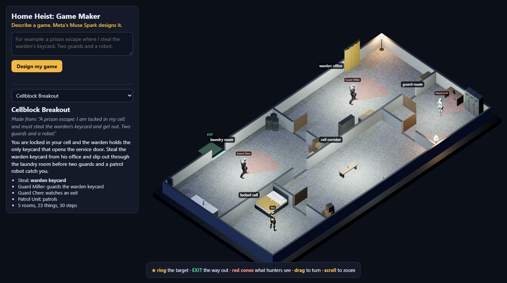 | 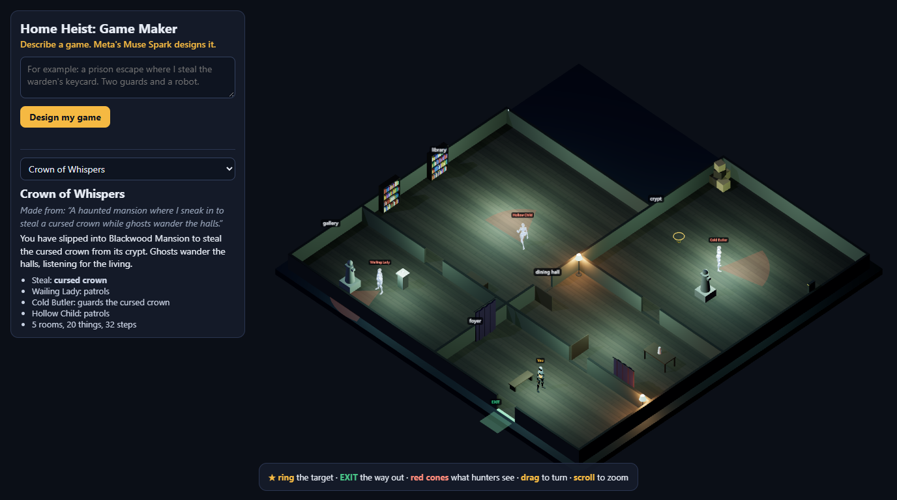 | 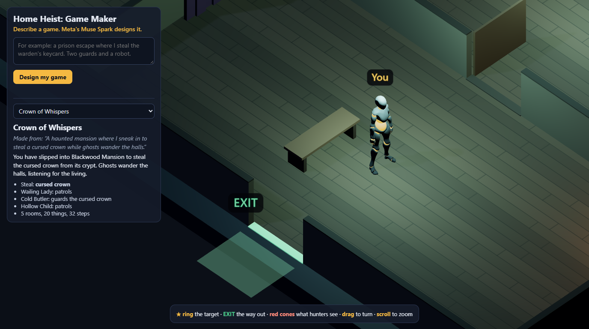 |

| Startup office | Racing, turned into a heist | Jewelry shop, typed into the page |
|---|---|---|
| 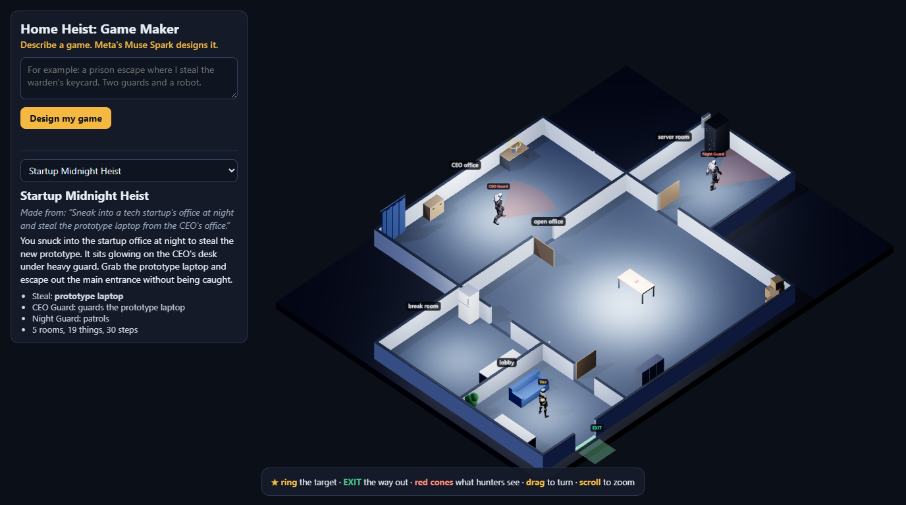 | 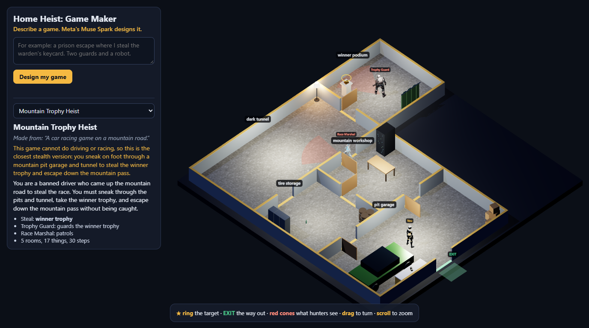 | 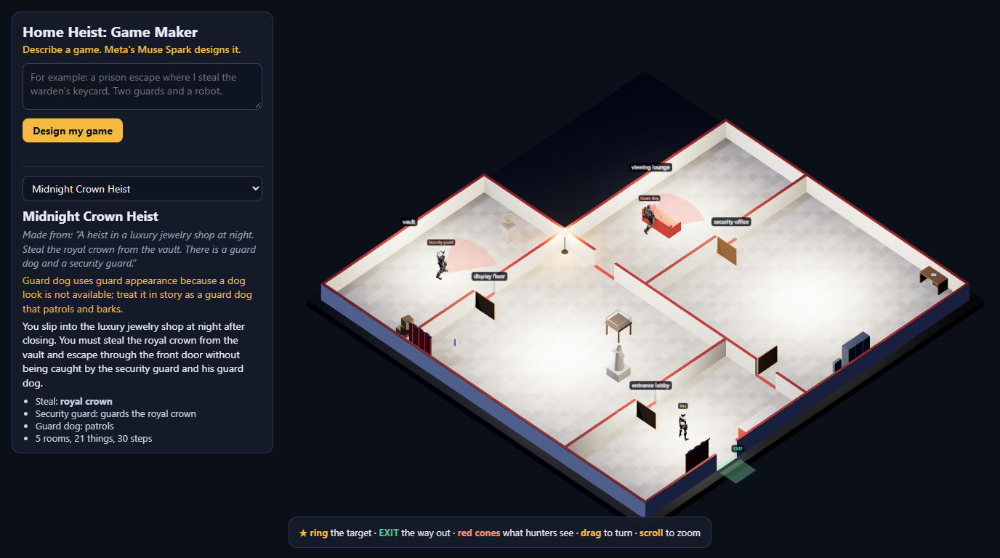 |

## Step 20: Speak your idea

**Request (Oct 29):** "add a voice functionality where I can just speak and instead of typing… it will generate."

**Model:** Meta's own speech-to-text model, `muse-voice-transcribe-1.0`, so the game uses one more Meta model. From [dev.meta.ai/docs/speech-to-text](https://dev.meta.ai/docs/speech-to-text):
- `POST /v1/asr/transcribe`, sent as `multipart/form-data` with two parts:
  - `request`: JSON with `model`, `audioEncoding: "WAV"` and `mode: "PUSH_TO_TALK"`
  - `audio`: the clip
- **Audio:** WAV only, mono 16-bit PCM at 16 or 24 kHz, up to 10 minutes and 32 MB.
- **Reply:** the words are in `transcript`, and the clip length in `audioDurationMs`.
- **Price:** $0.18 per hour of audio, billed in whole seconds.

**How it works:**

```
Speak button → the browser records (it stops by itself after a 1.6-second pause, or after 30 seconds)
  → public/voice.js turns the recording into WAV: one channel, 16 kHz, 16-bit
  → POST /api/transcribe → the server checks the WAV header (src/voice.ts) → Meta's Muse Voice → the words
  → the words fill the box, and the design starts at once
```

**What was built:**

| File | What it does |
|---|---|
| `public/voice.js` | Records from the microphone, notices when you pause, and converts the recording to 16 kHz mono WAV, because browsers don't record WAV themselves |
| `src/voice.ts` | Reads the WAV header and refuses clips in the wrong format before anything is paid for |
| `src/ai/meta.ts` | `MetaClient.transcribe()`. The request helper can now send a form with a file. Audio costs are tracked by the second. |
| `src/ai/index.ts` | `createListener()`. There is no offline stand-in, so without a key the page says voice needs one. |
| `src/server.ts` | `POST /api/transcribe` takes a WAV clip of up to 60 seconds and returns the words, the length and the cost |
| `public/levels.html`, `levels.js` | A **Speak** button with a live sound meter. A second click stops early. Errors for a blocked or missing microphone are written in plain words. |
| `scripts/playtest.mjs` | Takes extra Edge flags in `EDGE_FLAGS`. With them, a pretend microphone plays a sound file, so the voice flow can be tested without a person. |
| `test/voice.test.ts` | 2 tests: good clips are accepted with their length; stereo, 44.1 kHz and non-WAV files are refused with a reason |

**How it was tested:**
- A spoken test clip was made with Windows' built-in text-to-speech voice: *"A pirate ship at night. I sneak into the captain's cabin to steal the treasure map. Two pirates guard the deck."*
- **Straight to the server:** Meta returned *"A pirate ship ship at night. I sneak into the captain's cabin…"* in **3.0 s** for **$0.00055** (11.4 s of audio).
- **Through the page:** Edge ran with a pretend microphone playing the clip, and the test only pressed **Speak**. The page then did the rest by itself:
  - It stopped listening at the pause.
  - It got the words back.
  - It designed **"Midnight Map Heist"**: a pirate ship with a captain's cabin, crew quarters, cargo hold, galley and main deck, guarded by two patrolling pirates. This took 2 tries and $0.061.

**Notes:**
- Both test runs doubled a word ("ship ship", "guard the guard the deck"). The test voice is a robotic text-to-speech voice. The designer understood the meaning anyway. Your own voice still needs a test by hand.
- Why the design needed a second try was not logged in this run. The server now prints what each failed try was sent back to fix.
- Your voice is sent to Meta's API, the same as typed ideas.

| Listening (the button pulses with your voice) | The level made from the spoken idea |
|---|---|
| 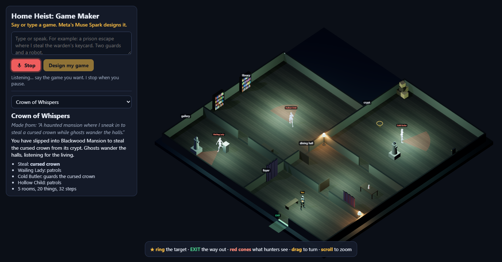 | 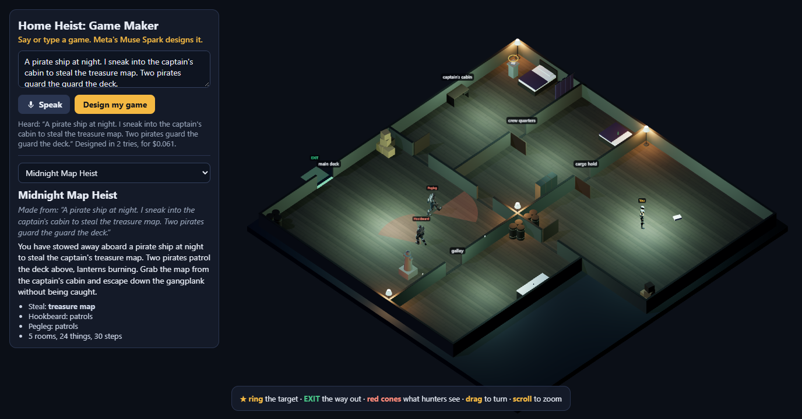 |

## Step 21: The "tree ant" test: outdoor worlds and creatures

**What happened:** the user spoke the first real voice test: *"Hi, I want to design a game uh where there's a tree and an ant moving around. The game's name should be tree ant."*
- **The voice worked:** Meta's model wrote the words down exactly.
- **The level was wrong.** It was a white lab with lockers and a sofa, the "giant ant" was a robot, and there was no tree.

**Why it went wrong** (from the saved level):

| Asked for | What the game had | What the designer did |
|---|---|---|
| a tree | only indoor furniture | renamed furniture: "root sofa", "bark wardrobe", "ant server" |
| an ant | only human-shaped characters (thief, kid, robot, guard, soldier, ghost) | made the player and the giant ant robots |
| a place in nature | 10 indoor styles | chose "lab" |
| — | the designer is told to explain changes | **its note was empty**: it hid the changes |

**What was fixed:**

| Change | Where |
|---|---|
| **Outdoor worlds:** `forest` and `garden` have no walls. Areas are open ground edged by hedges (taller around the edge, low between areas, and not blocking the view), joined by dirt paths. Lit by the moon; lamps become lantern posts. Also a `cave` style. | `catalog.ts`, `level-builder.js` |
| **Nature things:** tree, bush, rock, hollow log, tall grass, mushroom, flowers; and leaf, berry and acorn to carry. A tree takes only its trunk's floor space, and its crown hangs over other things. | `catalog.ts`, `level-builder.js` |
| **Creatures with walking legs:** ant, beetle, spider, bee (hovers, wings beat), dog, cat, mouse and bird. They are built from simple shapes and animated in code. Insects walk in two tripods of legs, four-legged animals trot, and birds hop. Anyone can be a creature, in any colour (`color`). | `public/creatures.js`, `characters.js` |
| **Anything else:** for a thing the catalog has no look for, the designer picks the kind that plays the right way and draws its look itself from up to 12 boxes, spheres, cylinders and cones (`parts`). Shapes with an unknown form or a bad colour are dropped. | `meta.ts`, `build.ts`, `level-builder.js` |
| **Honesty:** the designer is told never to disguise unrelated furniture. `note` must say how the idea was fitted into the game, and `missing` must list anything it couldn't show. The page shows both. | `meta.ts`, `levels.js` |
| **Tight rooms:** a piece that doesn't fit with a walkway around it gets a second try closer together | `level-builder.js` |

**The same sentence again** (typed exactly as Meta wrote down the user's words): **1 try, $0.029.** The result:
- **Style:** `forest`.
- **Areas:** the mossy entrance (the start and the exit), the old oak (with a big tree and a hollow log), the mushroom hollow and the ant nest.
- **Characters:** the player is a **black ant**, and the hunter is a **red ant** that patrols between the oak and the nest.
- **The designer's note:** *"Added a big oak tree and a patrolling red ant; the golden acorn in the nest is your target to steal and escape."*
- **Everything fits:** no "did not fit" warnings, after the tree-trunk fix.

**Limits:**
- The rules are still the same for every level: take the target and get out.
- The ant world is not to scale: the ants are about 1.2 m long, so they can be seen.
- `parts` has not been seen in use yet: the designer used only catalog looks for this idea.

| Before (the user's screenshot) | After: the same sentence | The red ant up close |
|---|---|---|
| 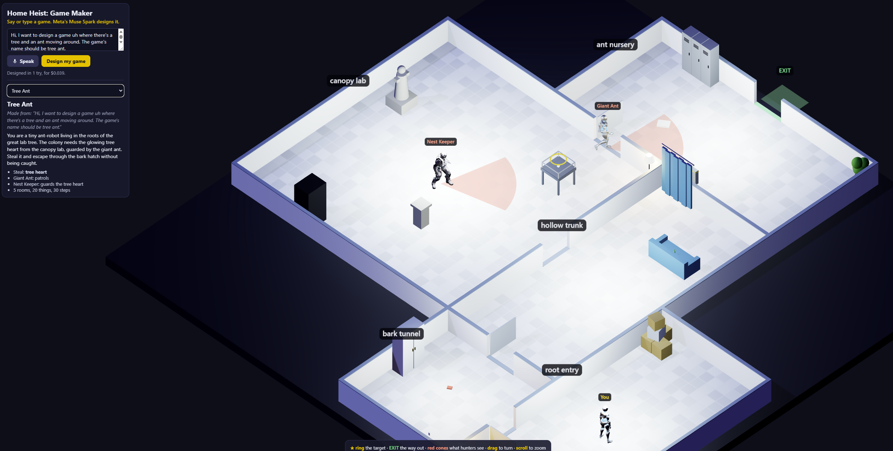 | 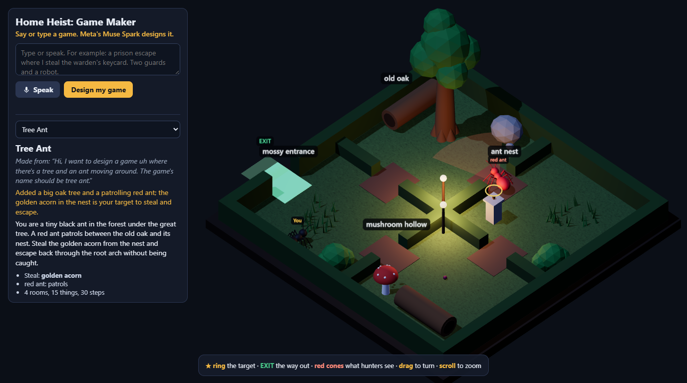 | 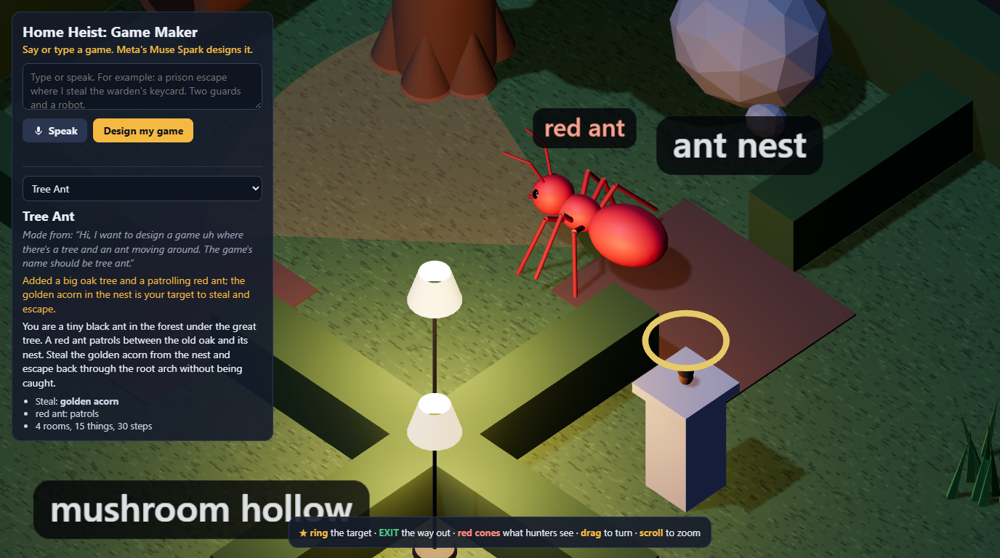 |

## Step 22: Speak any game: the AI writes the game itself

**Decision (Oct 29):** the user wants a system that can make **any game**, literally, with no single format or template. It starts with small indie games and grows from there. A template can never do that, because every genre needs its own rules. So the AI now writes each game's code itself.

**How it works:**

```
"a racing game on Mars"  (typed, or spoken through Muse Voice)
  → the writer (muse-wonder-1.0) writes a whole game as one JavaScript module: rules, controls, levels, win and lose
  → the game runs in a sealed frame, using the game kit and three.js
  → a test browser (headless Edge) plays it: it waits for the first frames, presses arrows, WASD and Space, clicks, and takes a screenshot
  → errors go back to the writer with the code, up to 2 fixes
  → you play it on make.html
```

**What was built:**

| File | What it does |
|---|---|
| `public/kit/kit.js` | **The game kit**, which every written game runs on: renderer and game loop, 6 skies, 12 grounds, simple shapes, the 50 ready-made things, the animated people and creatures, follow, overhead and side cameras, keys and pointer, a heads-up display (text, big titles, controls, bars), 10 synthesized sounds, particle bursts, simple collisions, timers, and win/lose with R to restart. Games can also use three.js directly. |
| `src/make/writer.ts` | The writer's instructions: any genre; keep the player's characters, names and rules; never change the kind of game; a clear goal; how it should look and feel; the whole kit reference. Strict JSON reply: title, pitch, controls, code. |
| `src/make/browser.ts`, `tester.ts` | The test browser, driven through Edge's DevTools interface, and the test: ready or not, errors, win/lose events, a screenshot |
| `src/make/maker.ts` | The write → test → fix loop |
| `src/make/games.ts` | Saves each game and its screenshot in `data/games/` |
| `public/sandbox.js`, `play.html` | The sealed frame and a page that plays one game |
| `public/make.html`, `make.js` | **Speak Any Game**: type or speak, make, play; a list of every game made |
| `src/tools/make.ts` | `npm run make -- "idea"` (the server must be running) |
| `src/server.ts` | `POST /api/make`, `GET /api/games`, `GET /api/games/<id>` |

**Safety:** the written code is new every time, so it runs sealed off:
- **A sandboxed iframe with no origin:** the game can't read this page, cookies or the API key, which stays on the server anyway.
- **A content security policy:** it may load scripts only from this server's kit and from jsDelivr's three.js, and it can't connect to this server at all.
- **No paid calls from a game:** the endpoints that cost money (design, make, transcribe) refuse requests without a proper content type, which a sealed frame can't send.

**Checked first without AI:** a small coin game written by hand ran in the sealed frame. It was ready, showed no errors, and collected 1 of 6 coins during the test.

**Results** (`npm run make`, three very different ideas, muse-wonder-1.0):

| What was asked | Game | Lines | Writing time | Versions | Cost |
|---|---|---|---|---|---|
| A racing game on Mars. I drive a rover around a track against the clock and collect fuel cans on the way. | **Mars Rover Rush**: 2 laps through 8 gates, fuel cans add time, a slowdown off the track | 237 | 57 s | 1 (no errors) | $0.135 |
| A platform game where a little robot jumps between floating islands in the sky to reach a golden star. | **Sky Island Robot**: 13 islands with trees above the sea, gems, lives, a timer and a progress bar | 341 | 68 s | 1 (no errors) | $0.160 |
| Hi, I want to design a game uh where there's a tree and an ant moving around. The game's name should be tree ant. | **Tree Ant**: an ant gathers 15 bits of food around a giant tree while dodging beetles; health and lives. **No heist.** | 204 | 56 s | 1 (no errors) | $0.100 |

All three took 18,769 output tokens in total, for **$0.395**. During the tests the ant collected 1 of 15 foods, and the rover passed into gate 1 of 8.

**Limits:**
- **"No errors" is not "fun".** The test catches crashes, not bad design. None of the three has been played by a person yet.
- **The look is simple:** shapes and the kit's things. The Mars mountains, for example, are big plain cones.
- **The games are small:** one file of a few hundred lines each.
- **The writer has never had to fix anything yet,** because all three ran first time, so the fix loop is untested with real errors.

**Next:**
- **Muse Wonder looks at the screenshot** and says whether the game matches what was asked; if not, it goes back for fixes.
- **Meta's models inside the games:** characters that think, and typed or spoken actions during play.
- **Longer automatic play tests.**

| Mars Rover Rush | Sky Island Robot | Tree Ant |
|---|---|---|
| 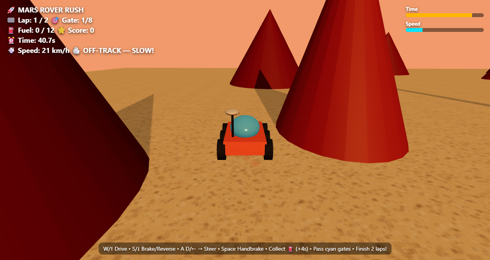 | 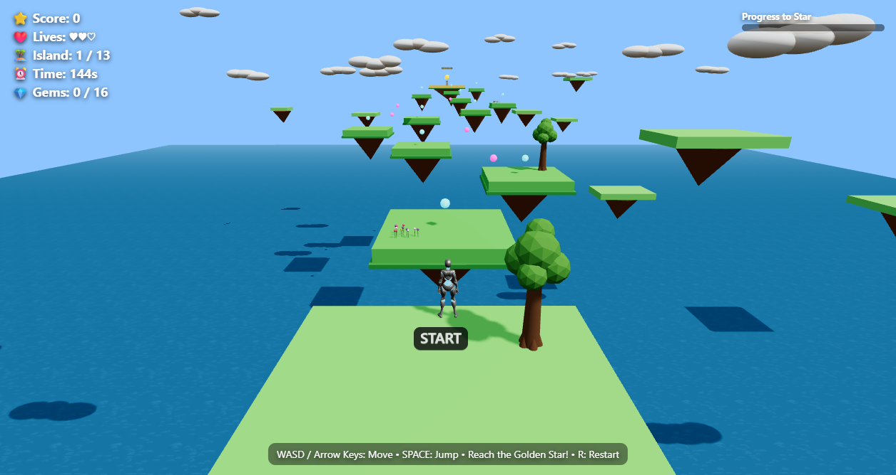 | 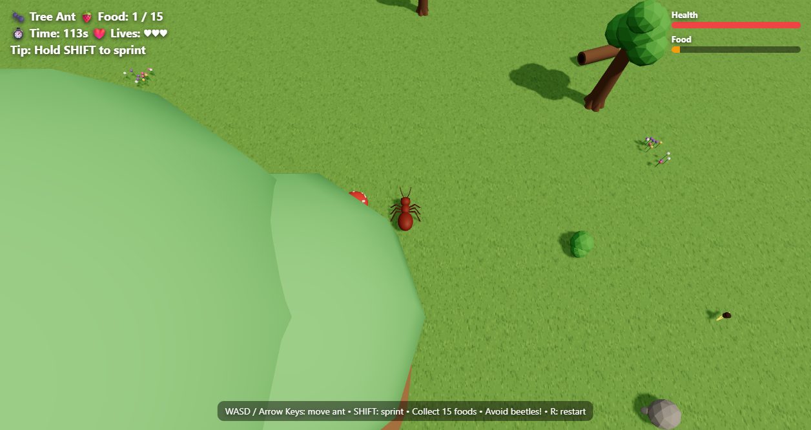 |

## Step 23: Real graphics: lighting, real 3D models, and a reviewer that looks

**Feedback (Oct 29):** the user made an F1 game from a detailed prompt and asked "what is this shit graphics? i need like real graphics". The game worked, but everything was built from boxes: the car was a stack of blocks and the grandstands were black slabs.

**1. Modern lighting in the kit** (`public/kit/kit.js`, so every game benefits, old ones too):
- **A real sky:** three.js's sky shader, rendered into a light map that also lights the scene and appears in reflections.
- **Materials:** a soft studio light for reflections in the other skies; `material:` presets `paint` (clear-coat), `metal`, `chrome`, `glass`, `rubber`, `matte` and `glow`; and new shapes, `rounded` (soft edges) and `capsule`.
- **Drawing passes:** 4× anti-aliasing, a glow that only bright things get, and colour-true tone mapping (Neutral).
- **Two bugs found and fixed while testing:**
  - **The F1 game drew a black screen.** A shape squashed to zero thickness produced invalid pixels, and the glow blurred them across the whole screen. Now shapes can't be flat, and a cleaning pass removes invalid pixels before the glow.
  - **The day sky washed everything out.** It was turned down.

**2. Real 3D models** (`public/models/`):
- **The pack:** Kenney's **Racing Kit**, CC0 (free for any use, credit optional), 112 models in 2.1 MB. It has race cars in 4 colours, grandstands, pit garages, barriers, banners, flags, light posts, gantries, tents, trees and road pieces. It was downloaded through Kenney's own "continue without donating" link; the licence is in `public/models/racing/LICENSE.txt`.
- `npm run models` measures every model in a hidden browser and writes `public/models/manifest.json`.
- `kit.model(name, { at, turn, scale, size })` loads a model once and copies it for every use, and centres it on its base.
- **A colour fix:** this Kenney pack saves screen colours as light values, so red showed as pink. The kit converts the colours on load and gives paint and glass a little shine.
- **The sealed frame may now load from `/models/`,** still never from the API.
- **The writer's instructions:** the model list, and a rule to use a model for anything that has one.

**3. A reviewer that looks at the game** (`src/make/reviewer.ts`):
- **What it sees:** the test takes two pictures, one at the start and one after playing. Muse Wonder looks at them with the request and lists clear problems a player would notice, such as missing things, a black screen or a blocked view.
- **What happens next:** the problems go back to the writer like errors do.
- **First test:** on the version whose road was invisible, it said in 9 s, for $0.02: *"Fix the missing asphalt circuit so the grid and start/finish line sit on a dark road with white edge lines instead of green grass."*
- **A tip for the writer:** road surfaces made from triangles often face down by mistake and vanish when seen from above. Use `side: THREE.DoubleSide`.

**The F1 prompt, made again each time:**

| Try | What happened | Cost |
|---|---|---|
| 1 | The prompt was cut at its first line break by Windows' `npm` command, so only "Make an F1 racing game called Grand Prix Rush" arrived. It now runs with `node src/tools/make.ts`. | $0.19 |
| 2 | The whole prompt arrived, but **no models were used**: the prompt describes how to build the car, so it built the car. | $0.21 |
| 3 | With the "use a model" rule: 13 models used, but **the road was invisible** (it faced down). | $0.21 |
| 4 | With the reviewer and the road tip: the road is visible, the reviewer saw no problems, and **13 kinds of model** are used (cars in 4 colours, covered grandstands, a gantry, pit garages, tents, flags, trees, barriers). Written in 173 s. | $0.34 |

**What still isn't right:**
- On the grid, the start lights also show as five big red balls in front of the camera.
- Seen from behind, the grandstands are plain white blocks.
- Only racing has real models so far. Other kinds of game need more packs: city, nature, characters, space, castle and so on.

| Before (the user's screenshot) | After: the grid | After: racing |
|---|---|---|
| 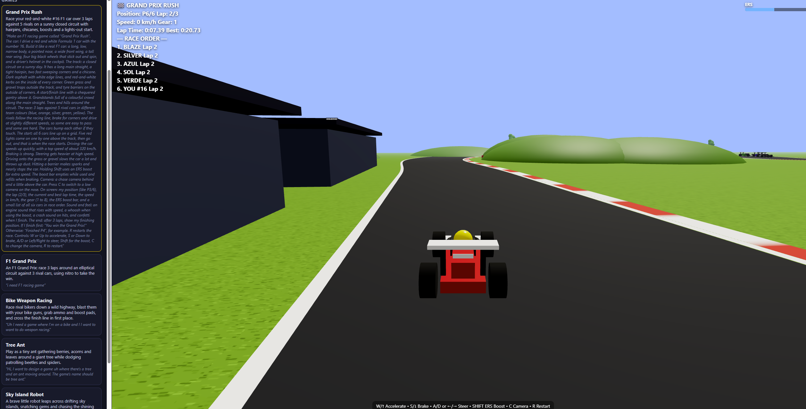 | 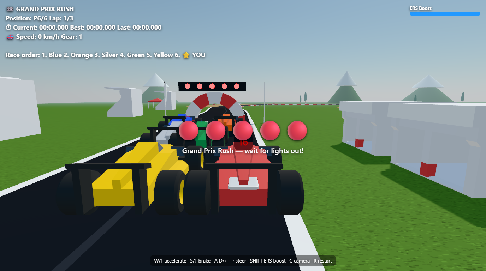 | 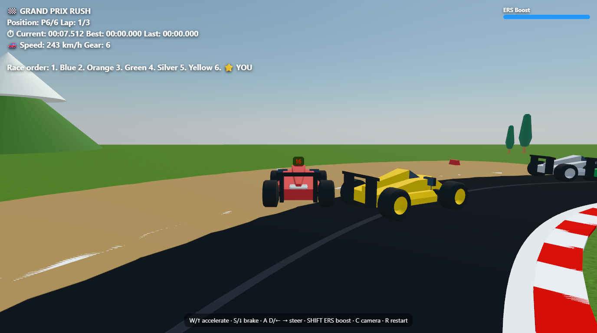 |

## Step 24: The realism test: real sky, scanned surfaces, a detailed F1 car

**Request (Oct 29):** "Have you seen the real F1 game, F1 2026? … I need same graphics here."
- **What the user was told first:** a big studio's F1 game can't be copied in a browser game made in minutes. It has licensed cars, tracks recreated from the real circuits, a big engine and console hardware.
- **What was offered instead:** a test of how far the kit can go. The user said: "make the impossible possible go ahead do it".

**What was added to the kit:**

| Feature | How |
|---|---|
| `await kit.sky("real")`: a real photographed sky | Poly Haven's *kloofendal_48d_partly_cloudy_puresky* (CC0, 2k HDR). It is the background, the lighting and the reflections. The sun's direction is found from the brightest point of the photo, so shadows match the sky. Shadows are 4096 px. |
| Real scanned surfaces | Poly Haven *asphalt_02*, *aerial_grass_rock* (tinted green, because it is a dry field) and *gravel*, all CC0, with colour, bump (normal) and roughness maps. Used by `kit.ground` and `kit.material`. |
| `kit.road(points)` | A track builder: asphalt with UVs in metres, white edge lines, red-and-white kerbs and gravel wherever the road bends, and a start line. It returns `pointAt`, `tangentAt` and `nearest`, for laps, racing lines and off-track checks. Games no longer build their own road surfaces, which is where the invisible road came from. |
| `kit.vehicle("f1")` | **A Formula 1 car built in code** (`public/kit/f1car.js`), to real size: 5.6 m long, 2 m wide, a 3.6 m wheelbase, 18-inch wheels. It has a lofted body, flat-topped sidepods, a halo, a helmet, multi-element front and rear wings, a beam wing, a diffuser, suspension arms, and tyres with compound bands. The paint is clear-coat and the carbon is a woven texture. Free of licences, and any colour or number. |
| A scanned concrete barrier | Poly Haven *concrete_road_barrier* (CC0), at real size: 1.55 m long and 0.83 m high |
| `kit.effects.speed`, `.vignette` | Motion blur from the centre that grows with speed, and darker corners |

Asset sizes: 20 MB in `public/assets/polyhaven` (licence in `LICENSE.txt`). Browsers may keep them for a day.

**The test scene, written by hand to see the ceiling:**
- **The sky and track:** a real cloudy sky, cracked real asphalt, mown grass, kerbs and gravel.
- **Around the track:** a pit wall of scanned barriers, and grandstands.
- **The cars:** three detailed F1 cars.
- **Speed:** motion blur at 205 km/h.

Fixed along the way:
- The cars were placed beside the road's curve, not on it; they now use `road.pointAt`.
- The car's shark fin was a big white sail, the sidepods looked like sausages, the carbon looked grey, and the paint was too metallic.

**The same F1 prompt through the AI** (writer, test, reviewer):
- **Version 1:** the reviewer saw rival cars sitting sideways on the grid, and big start-light balls blocking the view.
- **Version 2** fixed both and passed the review. 2.9 min, $0.44.
- **What it uses:** the real sky, `kit.road`, `kit.vehicle("f1")` and motion blur.

**Honest result:** it looks far more real than the boxes or the Kenney models, roughly like a good racing game from 10–15 years ago, but it is not F1 2026:
- **The cars:** the built-in car is good from the chase camera but simpler than a real F1 car up close. There are no sponsor liveries or fine aero details.
- **The grandstands** are still cartoon models, and there are no crowds or real trees.
- **A blind spot in the test:** it drove into a grandstand that the AI had placed right next to the track, and the camera went inside it. Track objects should sit behind barriers.
- **The start line** shows as white, not chequered.

| Realism test (hand-made) | Motion blur at 205 km/h | The F1 car built in code | The AI's version of the F1 prompt |
|---|---|---|---|
| 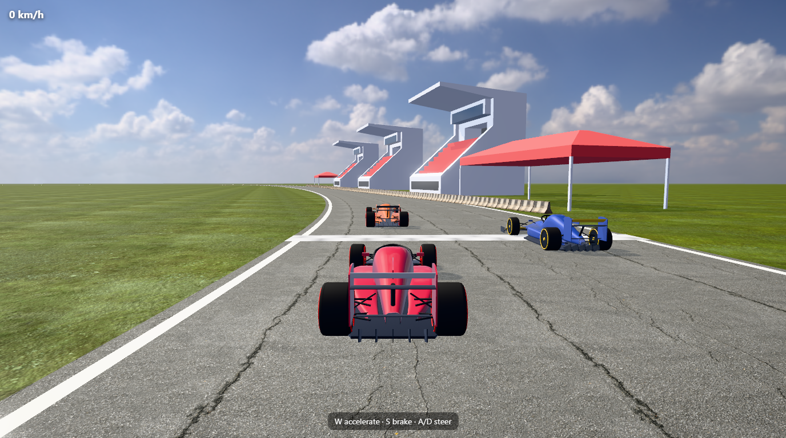 | 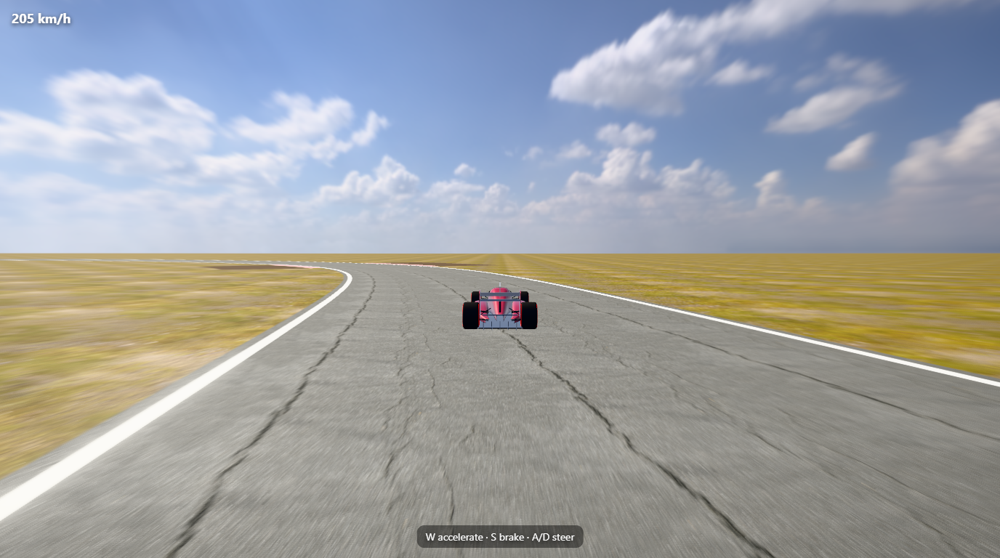 | 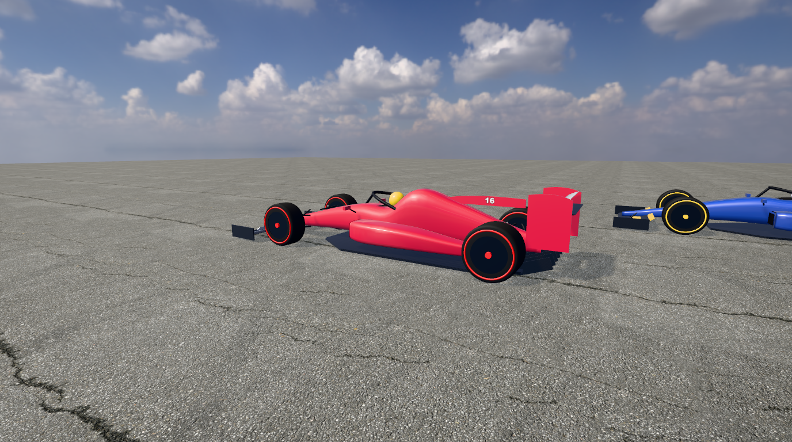 | 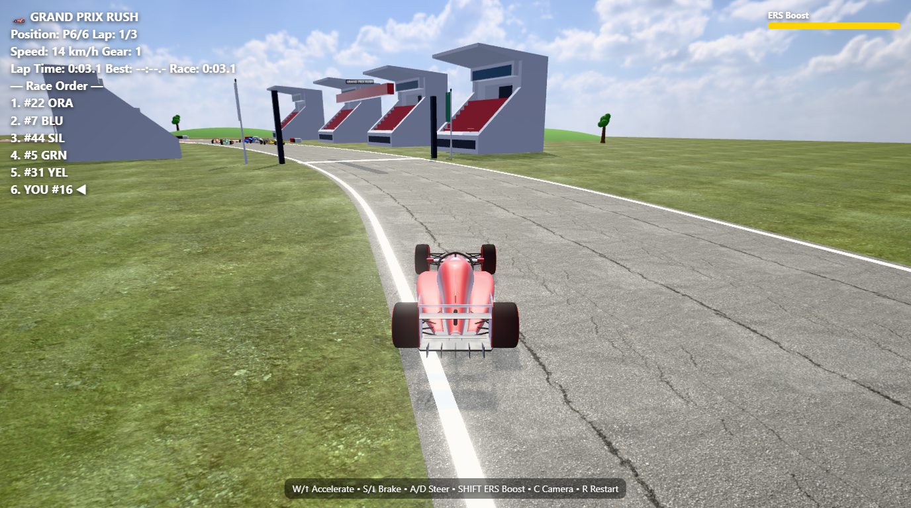 |

## Step 25: Meta's AI inside every game: world model, minds and learning

**Request (Oct 30):** "just wanted to remind you what about the world model."
- **The gap:** the world model, learning guards and teacher from Home Heist only ran in the original turn-based game. Games made by Speak Any Game were plain code with fixed rules.
- **Plan explained first:** give every written game a world model to call while it runs, minds for its characters, and learning between rounds. The game stays sealed and asks the page around it.

**How it works:**

| Part | What it does | Model |
|---|---|---|
| `kit.world({ about, state, can })` | The game says what it is, what is happening now, and which changes the AI may make (for example `oil(metres)`, `fence(chicken)`, `rain(on)`). The player presses **Enter** and types or says anything. The model replies with a story for the player, what the characters could notice, and changes chosen only from the game's list. | `muse-spark-1.3` |
| `kit.mind({ name, about, sees, can, every, body })` | A character chooses one of its plans every few seconds from what it can see, and sometimes speaks (shown above it). It also thinks straight away when the world changes something it would notice. | `muse-spark-1.3` |
| Learning | After a win or loss, the round's history (what the player tried, what the world decided, what each character chose and why, the game's notes) goes to Muse Wonder. It writes up to 6 rules for the world and 4 lessons per character. They are saved in `data/worlds/<game>.json` and shown at the start of the next round. | `muse-wonder-1.0` |

**Safety and cost:**
- **The game still runs sealed.** It posts a question to the page around it (`sandbox.js`), which sends at most 3 at a time to `POST /api/live`.
- **The server checks everything:**
  - the game id, sizes and change names;
  - the inputs must be numbers, words, true/false or a list of allowed words.
- **The reply format is built from the game's own changes** (strict JSON schema), so the model can't invent a change.
- **Limits:** $2 of AI per run of the server, and 40 calls a minute.
- **What the characters are told:** what they could notice ("a shoe clatter from the east hall"). They are never told what the player typed.

**Tests:**

1. **Speed setting (a probe of 3 calls):**

| Setting | Time | Cost | Result |
|---|---|---|---|
| `reasoning_effort: "low"` | 5–7 s per answer | $0.004 | Refused "pour oil on the track" because a real F1 car carries no oil |
| `"minimal"` | 2–3 s per answer | $0.0017 | Let the oil idea work, and still refused "I win the race right now" |

`"minimal"` is used for the world and the minds.

2. **A hand-made game, "Henhouse Night":** a kid guards 3 chickens from a fox with a mind.
   - The fox went for chicken 2, and I typed "I build a fence around chicken 2". The world built it (`fence(2)`).
   - The fox's next thought was "Kid guards middle, flank to side chicken", and it took a side chicken.
   - After the round (the player won, saving 2), Muse Wonder wrote lessons for the fox, such as *"Use chicken 2 as a feint to draw the kid to the middle, then flank quickly to chicken 1 in the west or chicken 3 in the east."*
   - In round 2 the lessons were shown at the start, and the fox's first thought was "flank east to chicken 3 early".
   - One learning call took 6 s and $0.03.
3. **Two games written by Muse Wonder with the new instructions,** both working on the first version:

| Words | Game | Time, cost | What Meta's AI did in the test |
|---|---|---|---|
| "A night heist in a museum… two guards patrol with flashlights…" | The Midnight Heist | 1.2 min, $0.21 | 6 world changes (coin distraction, lights out, smoke bomb…) and two guards with minds. When the shoe clattered in the east hall, Vera went to check ("Heard that, checking east hall!") and Marco stayed at the statue ("Nice try, I'm watching the statue!"). |
| The user's own spoken idea from Oct 29: "Uh I need a game where I'm on a bike and I I want to want to do weapon racing." | Bike Blast GP | 1.0 min, $0.17 | Two rival riders with minds ("Eat my dust."). "Drop oil behind me and give me ammo": the oil worked, the free ammo didn't ("grab yellow boxes"). |

| You try something | The world decides | After the round | Round 2 |
|---|---|---|---|
| 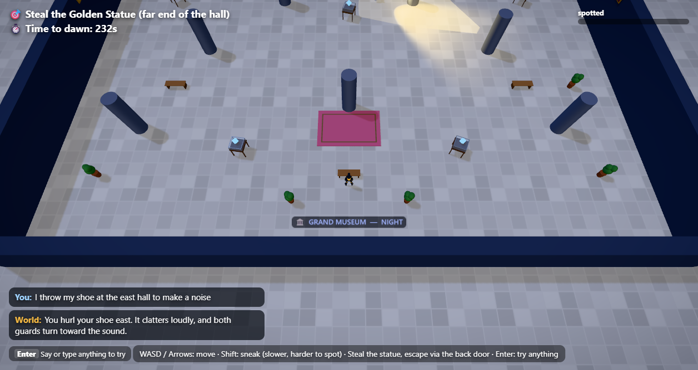 | 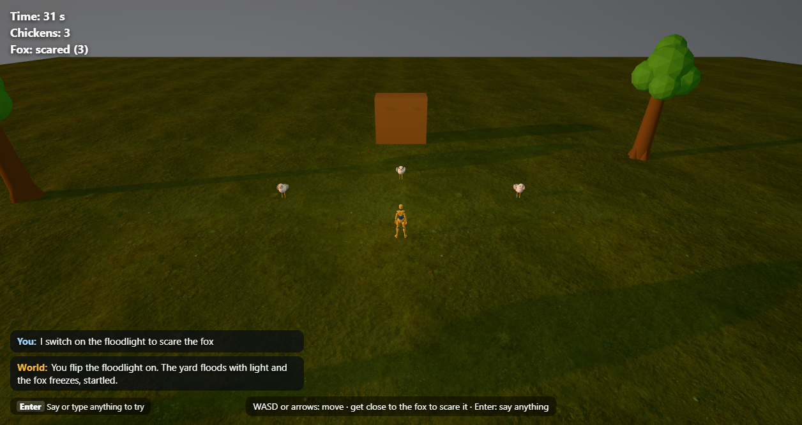 | 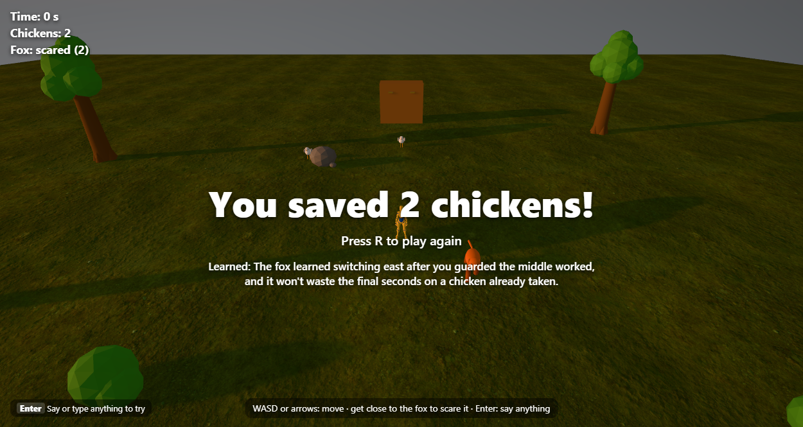 | 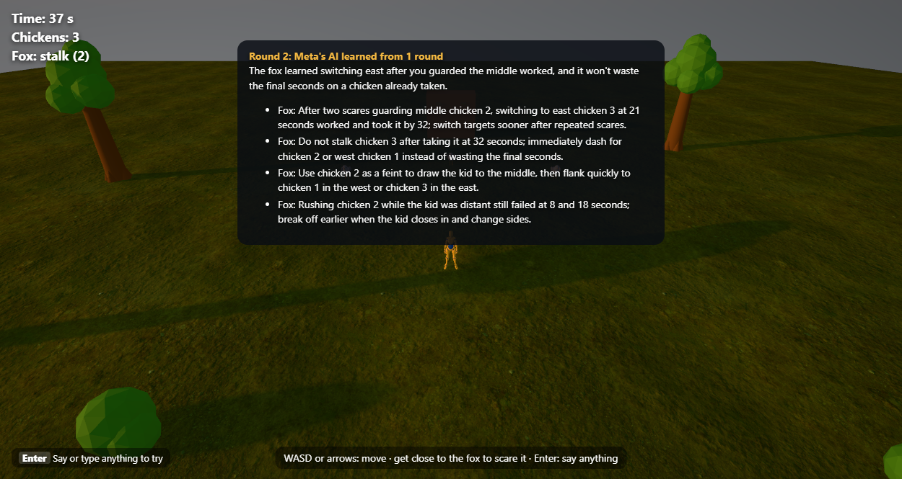 |

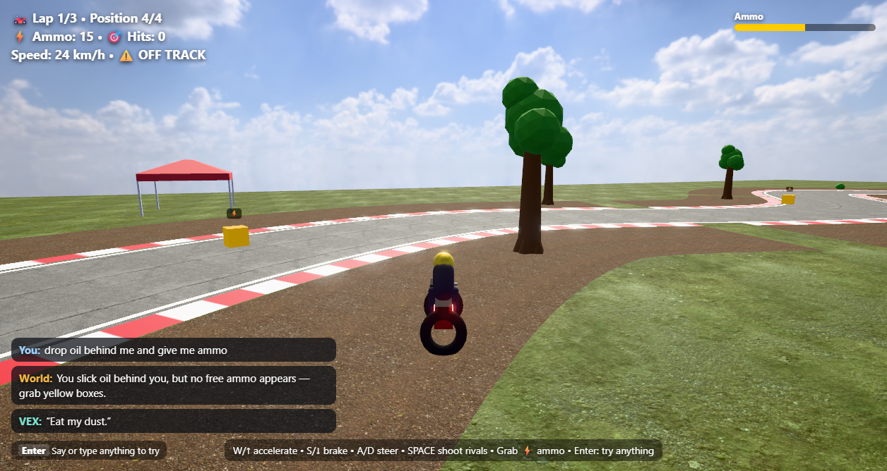

**On the game maker page** (make.html), the panel on the left shows every question and answer live: what you tried, what the world decided, and each character's thinking. Below, "I cut the power to the museum lights" became `lights_out`, and the guards kept patrolling in the dark:

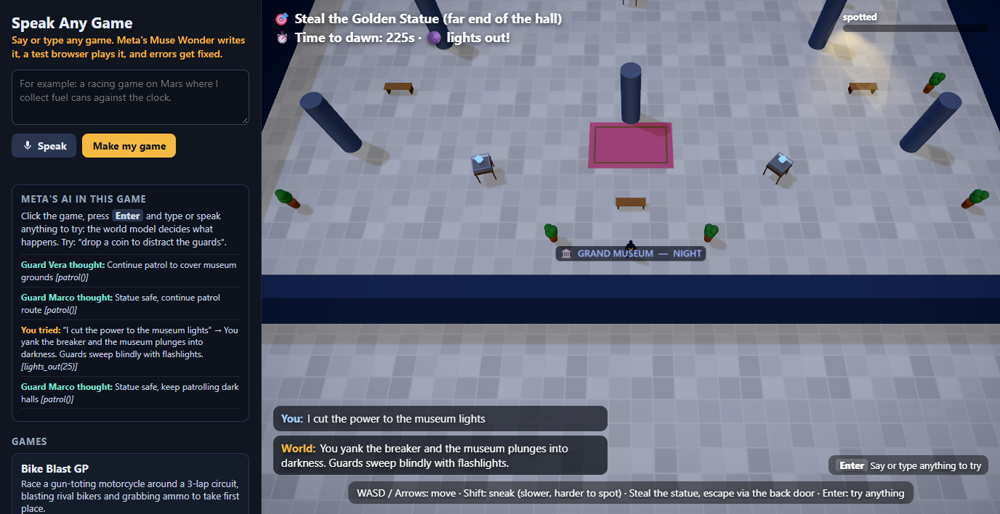

- **Also fixed:** on the narrower game area of this page, the Enter hint covered the game's controls line, so it moved to the right, above it.

**Fixed along the way:**

| Problem | Fix |
|---|---|
| The typing box stayed on screen after sending: a style rule beat the `hidden` setting. | The rule now gives way to `hidden`. |
| The guards' next thought ("keep patrolling") cancelled the distraction the world had just made. | Every mind now thinks right after the world changes something. |
| The guards were told the player's typed words and the player's version of events ("*You* hurl your shoe"), so they knew too much. | The world model now also writes what the characters `noticed`, and that is all they get. |
| A learning request and the next round's first question could arrive together, and the question might miss the new lessons (found by a new test). | Learning is now registered before anything waits. |

- **Tests:** 7 new (checking calls, change lists, the reply format, picking only offered changes, merging lessons, the budget and rate limit, waiting for learning). Now 35, all passing.
- **Spend this step:** about $0.60 by our estimate: two games $0.38, playtests and probes about $0.2.

## Step 26: No Engine: a game with no game code

**Request (Nov 2):** "i need a crazy frontier topic i think the world model theme is not working". Then: "something … very advanced … it stands out literally."
- **What the user was shown first:** 5 big ideas.
- **They chose "No Engine":** a game with no 3D engine, no physics code and no graphics code, where Meta's AI is the whole engine. This is what Odyssey's Agora-2 and Google's Genie chase, here built on Meta's models.
- **Shown before building:** a real 5-moment example, not a mock-up, opened as a page. The user said "go ahead".

**How it works:**

| Job | Model | What it does |
|---|---|---|
| The game engine | `muse-spark-1.3` | Invents the world from your words (title, goal, look, characters, facts). On every move it decides what happens, other characters included, and keeps the complete list of facts. Those facts are the whole state of the game. |
| The painter | `muse-image-1.0` | Paints the opening from words (`/v1/images/generations`, about 17–20 s). Each later frame **changes the last frame** (`/v1/images/edits`, `reasoning_strength: "low"`, about 10 s), so it stays one place. |
| Memory between rounds | `muse-wonder-1.0` | After a win or loss, writes what the characters will remember about this player. The next round is the same world: the same title, goal, look and characters, and its opening is painted from the last round's opening. |
| Voice | `muse-voice-transcribe-1.0` | Speak the world, and speak every move. |

- **The page:** `public/paint.html` and `paint.js`.
  - The frame fills the screen, the story shows as subtitles, and you type or speak each move.
  - "Facts & moments" shows the world's facts and every frame so far.
  - The end screen has "Play again: they'll remember you".
- **The server:** `src/paint/engine.ts` (`NoEngine`), with endpoints `POST /api/paint/start | act | again` and `GET /api/paint/<id>` and `/<id>/<n>.jpg`.
  - **Faster feeling:** the story comes back as soon as Muse Spark decides, and the frame request waits until it is painted.
  - **Order:** frames paint in order.
  - **Limits:** one move at a time per world, and $3 per run of the server.
  - **Saved:** worlds are kept in `data/painted/`.

**Tests on the real models:**

1. **The example (5 heist moments, one script):** $0.08 in all.
   - The picture remembered what happened: after the shoe throw, the figure was barefoot; after the grab, the pedestal was empty and the statue was in its hand.
   - The image filter refused "throw it hard toward the east hall". The world model now writes pictures in calm, neutral words, and if a picture is still refused, Muse Spark rewrites it and it is painted once more.
2. **Speed of an edit:** `"low"` took 10.0 s and `"high"` 15.8 s, with no visible difference. Edits use `"low"`.
3. **The page, played in a test browser:** "I'm a pirate captain in a storm, and a rival ship is chasing us", then 3 moves.

| Move | Decided | Painted |
|---|---|---|
| (the opening) | 8.3 s | 21.6 s |
| "I order the crew to turn hard into the waves and raise every sail" | 4.7 s | 12.8 s |
| "I fire a flare into the sky to blind their lookout": the sky turned red and stayed red | 6.8 s | 9.9 s |
| "I steer us through the narrow rocks by the lighthouse" | 5.9 s | 27.7 s |

4. **Two rounds of the museum heist:**
   - **Round 1:** the shoe pulled Marcus away. Elena saw me at the statue, and I was caught at the stuck door.
   - **Round 2:** Muse Wonder wrote what they remember, for example *"Elena remembers you sprinted straight to the statue while the guards looked away, so next time she will keep her beam on the pedestal during any noise."*
   - Round 2 opened in the same moonlit hall, and a guard was now standing watch.

| The start | "Raise every sail" | The flare | The lighthouse |
|---|---|---|---|
| 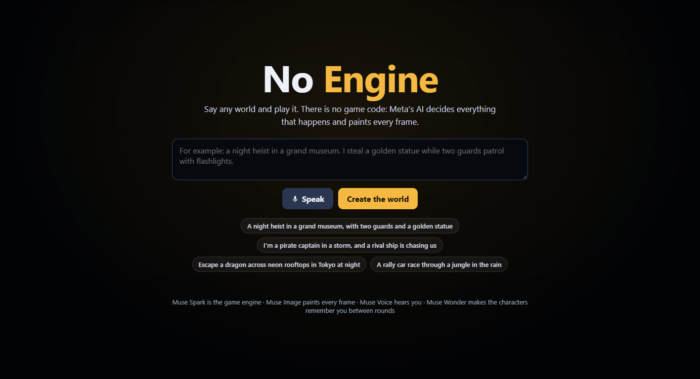 | 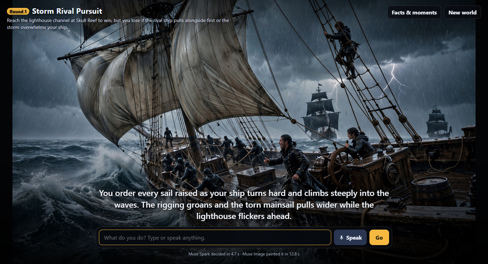 | 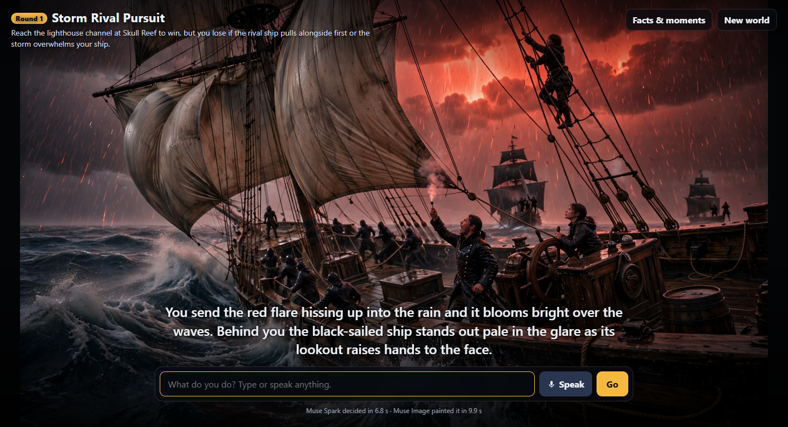 | 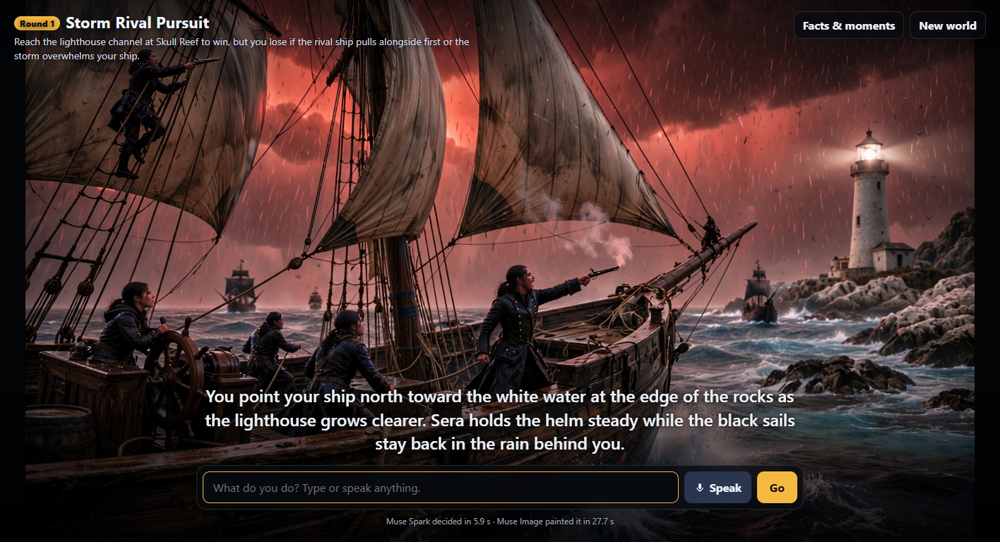 |

| The example: the beginning | The shoe (barefoot now) | The statue taken | Round over | Round 2: they remember |
|---|---|---|---|---|
| 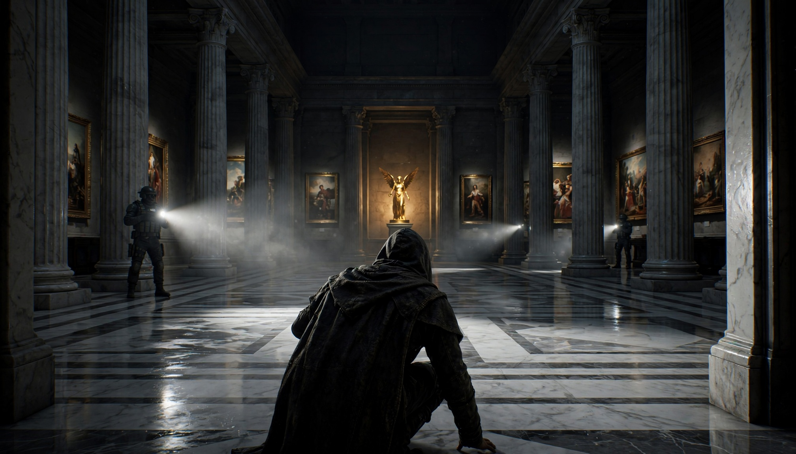 | 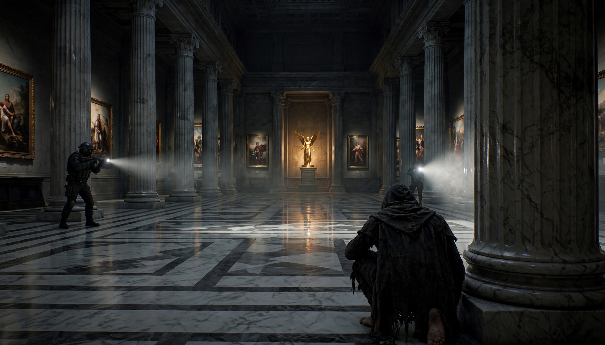 | 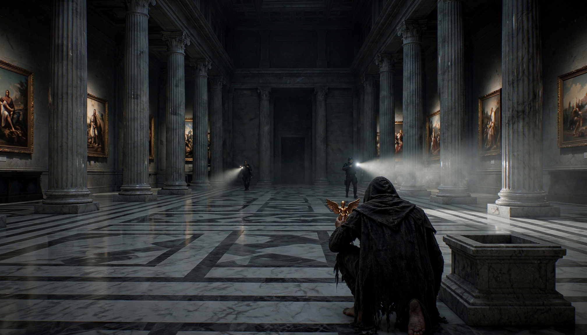 | 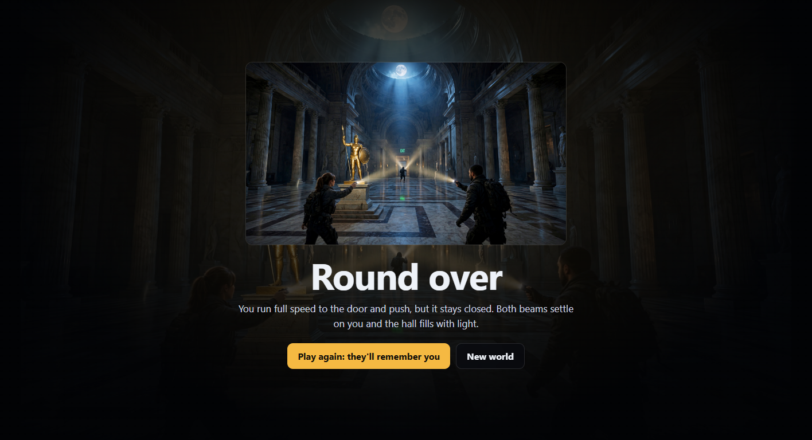 | 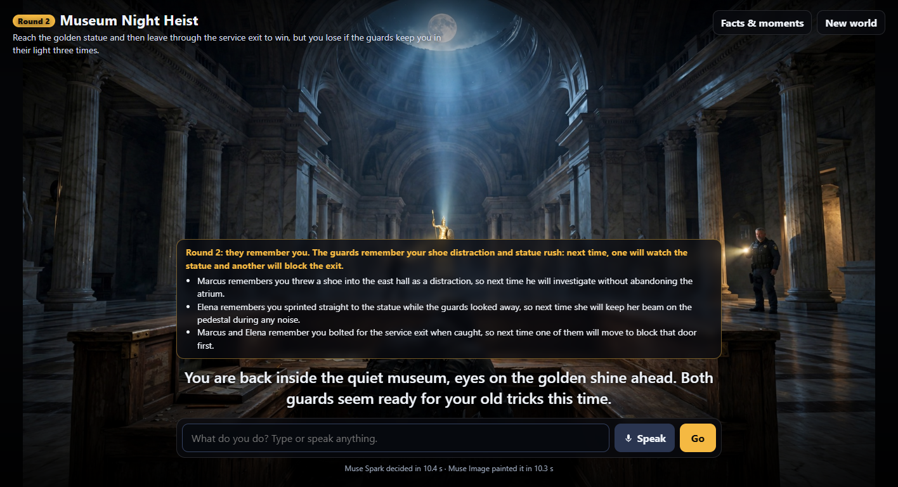 |

**Fixed along the way:**

| Problem | Fix |
|---|---|
| Moves typed in the test browser never arrived, because the Enter key didn't submit the form. | Enter is handled directly. |
| The game's story showed through the end screen. | It is hidden there. |
| Round 2 was a different place (a sunny dome, a new title). | The next round now keeps the world and is painted from round 1's opening. |
| A failed frame save could have stopped the server with an unhandled error (found by a test). | Painting errors are always caught. |
| Two worlds made in the same millisecond got the same id (found by a test). | Ids have a random part. |
| A new round could start painting before the last round's first frame was saved (found by a test). | It now waits for that frame. |

- **Tests:** 4 new (painting in order from the last frame, the calmer-words retry and failed frames, one move at a time and the next round remembering, saving and the spending limit). Now 39, all passing.
- **Spend this step:** about $0.45 by our estimate. A move costs about $0.012 ($0.01 for the picture and about $0.002 for deciding).

**Honest limits:**
- **It's a living painting, not a smooth real-time game:** each move takes about 15–35 seconds.
- **The painter sometimes adds things:** guards with gun-like flashlights, or the statue stuck on the figure's back.
- **The world model is good but can bend facts:** one opening put the exit on the roof, and a later move used the back door.

## Step 27: Rewind: a world model that runs time backwards

**Request (Nov 4):** the user moved the entry away from games ("leave this games idea, give me other really not ever done frontier ideas").
- **6 ideas were offered.** The user chose **Rewind**: from one photo of an aftermath (their examples were a car crash and a plane crash), go back in time, work out the direction, angle and how it happened, and list all the possibilities and what went wrong.
- **The plan was written and approved first.** With under 4 hours left before the deadline, only the core was built: no follow-up questions, no separate physics check, no SAM outlines.

**How it works (`src/rewind/engine.ts`):**
1. **Muse Wonder (vision) gets the photo** and what the person knows. Its strict schema returns the scene, 3–8 pieces of evidence with positions on the photo, and 2–4 explanations. Each explanation has a likelihood, the physics, a 3-moment timeline (what happens, and a picture description), the evidence for and against, and prevention.
2. **The investigation is cleaned up:** pins are kept on the photo, likelihoods are scaled to add up to 100 and sorted, and moments go earliest first.
3. **Muse Image paints the moments backwards.** The one closest to the photo comes first, made by changing the real photo; each earlier one changes the picture after it. That keeps the real place.
   - The prompt removes anything made later (tyre marks, dents, debris).
   - A refused picture is rewritten by Muse Spark and painted once more.
4. **Endpoints and storage:**
   - `POST /api/rewind/start` (a JPEG data URL, shrunk to ≤1600 px by the page) and `POST /api/rewind/paint`.
   - `GET /api/rewind/<id>`, plus `/photo.jpg` and `/<h>-<n>.jpg`, which waits while a moment paints.
   - Cases are saved in `data/rewind/`.

**Tests on the real models:**

1. **Feasibility (a script):** Muse Image made an aftermath photo, a silver sedan against a bent guardrail on a wet road.
   - **Muse Wonder (26 s)** found 6 pieces of evidence and 4 explanations: a wet curve slide at 60%, hydroplaning 20%, a swerve 12%, a tyre or steering fault 8%.
   - **The physics was specific:** "50–70 km/h … grip μ about 0.3–0.4 … slid along a 15–25 m radius arc".
   - **The 3 moments painted in 33 s** with no filter refusals.
   - **The whole case cost $0.117,** including the test photo.
   - **One problem:** the tyre marks were already on the road 10 seconds before. The painting prompt now removes anything made later.
2. **The page in a headless browser (Edge):** click the example, wait, then Play.
   - **The investigation (23 s):** 7 evidence pins, with 60% "wet bend loss of grip", 25% "swerved right to avoid something" and 15% "hydroplaning on standing water".
   - **The moments:** at 10 s before, the car's headlights are far away on a clean road; at 1 s before, the undamaged car slides toward the rail.
   - There were no page errors.

| Start | The case | 10 s before | 1 s before |
|---|---|---|---|
| 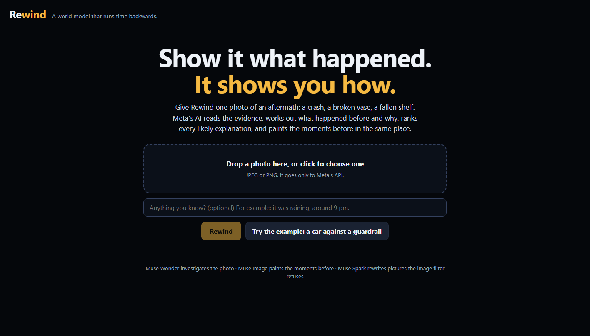 |  | 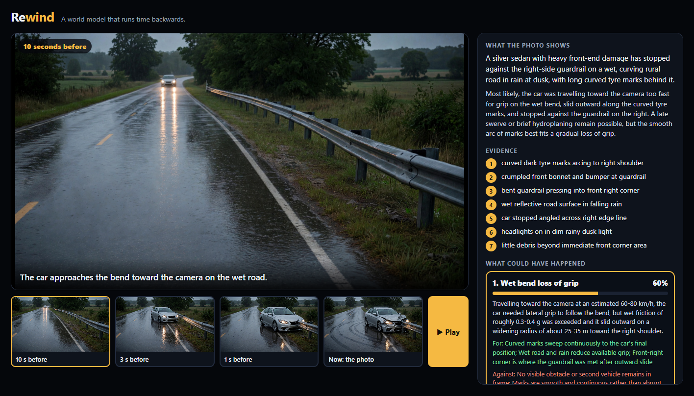 | 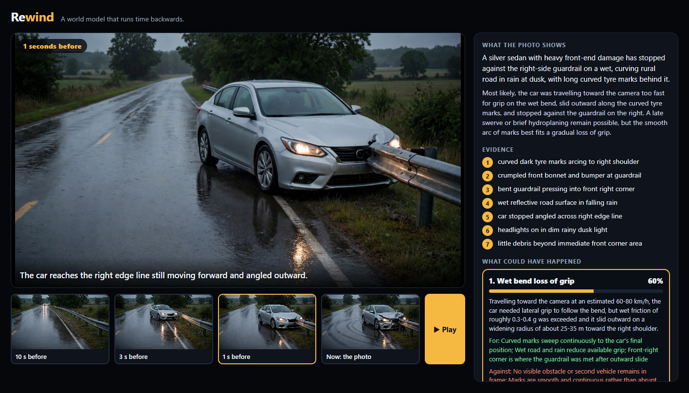 |

- **Tests:** 2 new (cleaning the investigation; painting backwards from the photo with the calm-words retry). Now 41, all passing.
- **Not done (for time):** follow-up questions by voice, a second physics check by Muse Spark, SAM 3.1 outlines of the evidence, and video input.

## Step 28: Real scanned models, surfaces and skies in every game (Poly Haven)

**Request (Nov 4):** back to the game maker, "building game with high graphics". The user chose "better 3D models", then said to do both (real models and realistic people), to show the final product, and to commit and push step by step.

**What was checked first:**
- **Poly Haven has 521 scanned models (CC0).** 468 have at most 150,000 polygons and are game-ready.
- **The rest are film-quality:** the pine tree has 17 million polygons and is a 950 MB download.
- **Its file server allows cross-site loading** (`Access-Control-Allow-Origin: *`), so games can load straight from it and nothing big is stored here.
- **One catch:** each model's glTF names its textures by a relative path that doesn't exist (404), so the loader has to redirect them.

**What was built:**

| Part | What it does |
|---|---|
| `npm run polyhaven` (`src/tools/polyhaven.ts`) | Indexes the library into `public/models/polyhaven.json` (730 KB): **466 models** (with polygons, download size, file map, and real size in metres worked out from each glTF's accessor bounds and node transforms, LOD0 only), **863 surfaces** (colour, normal and roughness maps) and **997 skies**. |
| `kit.model("polyhaven/<id>")` | Loads from `dl.polyhaven.org` with the textures redirected. It keeps only LOD0, keeps the real materials, and puts the base at `at` at real size. A model that fails to load logs a warning instead of stopping the game. |
| `kit.sky("polyhaven/<id>")` | Any of the 997 photographed skies (2k HDR), with the sun placed at the photo's brightest point. |
| `kit.ground({ type: "polyhaven/<id>", metres })`, `kit.material("polyhaven/<id>")` | Any of the 863 scanned surfaces. |
| The sealed frame (`sandbox.js`) | Its content policy now allows `https://dl.polyhaven.org` for files and images. The API is still unreachable. |
| The writer | Gets the 466 models grouped by kind with real sizes (heavy ones marked *), plus curated surfaces and skies, and is told to prefer them over shapes. The instructions grew to about 40,000 characters. |

**Checks:**
- **Two look tests** (`public/lab/realistic.html`): a pirate cove and a living room.
  - The room looked real: scanned furniture, a plaster wall surface, real interior sky light, and contact shadows (GTAO).
  - The pirate cove was weaker: the sea and sky looked washed out.
- **A hand-made game through the kit in the sealed frame** loaded the sky, 9 models and two surfaces with no errors.
- **Tests:** 1 new (model size from glTF bounds, ignoring LOD1). Now 42, all passing.

| Through the kit, in the sealed frame | The pirate look test |
|---|---|
| 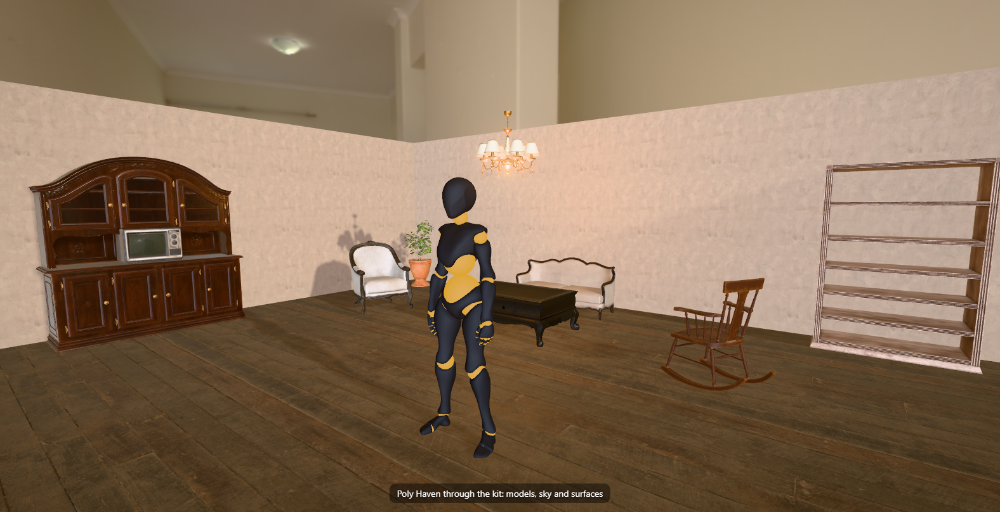 | 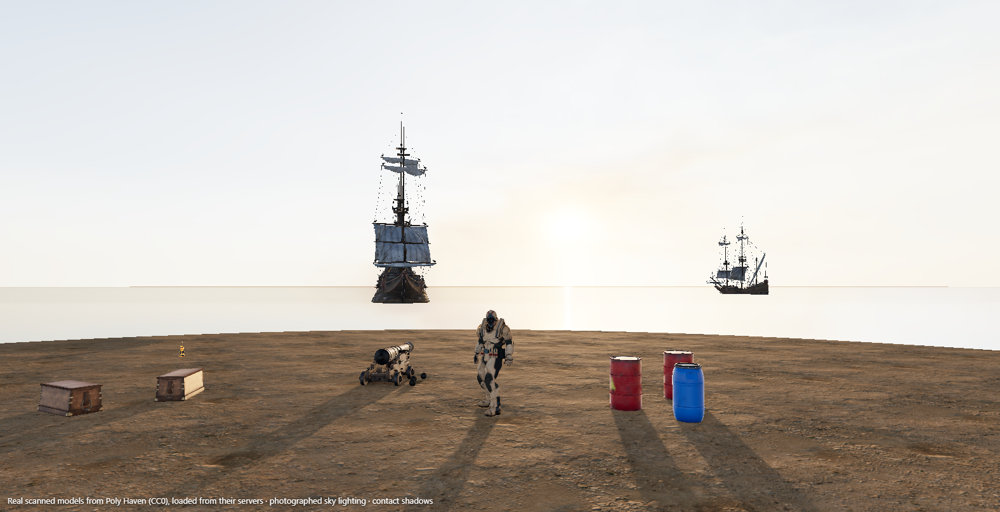 |

**Still missing:** realistic people (the only free animated characters are the sci-fi soldier and a mannequin), game-weight trees, and modern cars. People come next, from Microsoft Rocketbox (MIT).

## Step 29: Real people in every game (Microsoft Rocketbox)

**The gap:** the only free animated people were a sci-fi soldier and a mannequin, which look wrong in a living room or on a beach.

**What was found:** [Microsoft Rocketbox](https://github.com/microsoft/Microsoft-Rocketbox), released under MIT.
- **People:** 115 realistic rigged people (74 professions, 40 adults, 4 children).
- **Animations:** 417 animations: 326 in place, and walk and run cycles that move forward.
- **Animals:** 25 animals, but with no animations.
- **The problem:** the source is FBX with 2048 px uncompressed TGA textures, about 85 MB per person.

**The converter** (`public/lab/rocketbox.html`, run by `npm run people`) does this in a hidden Edge window:
1. Loads the FBX and its textures straight from GitHub. Specular maps are skipped.
2. Rebuilds the materials, with colour at 1024 px JPEG and bump maps at 512 px, and stands the person up facing +z, in metres.
3. Exports one GLB per person (body only).
4. Exports the **shared animations once per gender**: idle, walk, run, crouch, look (around), cheer and talk.
   - Only joint rotations are kept, plus the hips' position, so every person keeps their own proportions.
   - The forward travel of walk and run is taken out so they loop in place.
   - The travel measures the speed that matches the feet: men walk at 1.01 m/s and run at 2.88 m/s; women walk at 1.21 m/s and run at 2.77 m/s.
5. Writes `index.json` with each person's description, height and hip height.

**In the kit:**
- `kit.character("Police_Male_01")` and the other 25 names give a real person. It appears as soon as its body loads; `play()` before that is remembered.
- The shared animations are fitted to each person by their hip height, so a 1.43 m child doesn't float.
- `character.speeds` gives the walk and run speeds.
- The writer gets all 26 people with descriptions and heights, and is told to use them for every human.

**Fixed along the way:**
- **Textures shrunk before they had arrived** (the FBX loads first): the converter now waits for the loading manager.
- **The first file was 5.4 MB:** the 11.7 s idle and the per-person animations made up most of it. Sharing the animations brought a person to about 3 MB.
- **People showed up all white in games:** the 3D loader unpacks pictures stored inside a GLB by fetching a `blob:` URL, which the sealed frame's content policy blocked. `connect-src` now allows `blob:`, which is the frame's own data and can't reach the network.
- **Two "athletes" were a swimmer and a woman in a bikini:** they were replaced with a football player and a woman in sportswear.
- **Closing the test browser could crash** when Windows still held Edge's profile folder: a leftover temporary folder is now ignored.

**Result:** 26 people (82 MB in the repo), heights 1.73–1.86 m for adults and 1.43 m for children. All 7 animations played for both genders.

| The converter's preview | All 7 animations, a woman and a man | The 26 people in the kit |
|---|---|---|
| 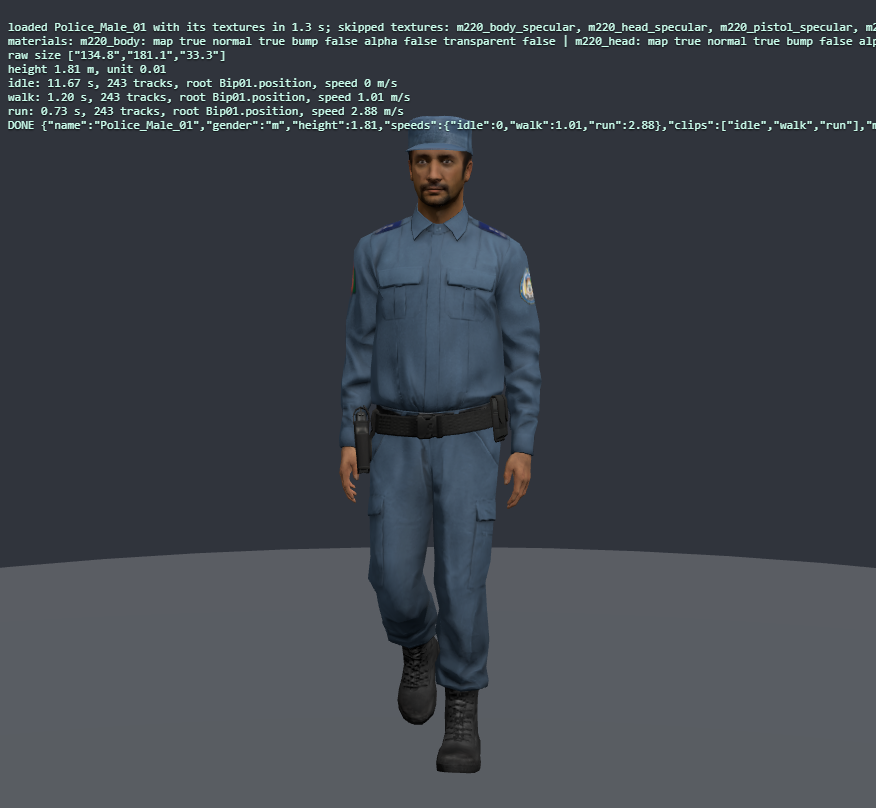 | 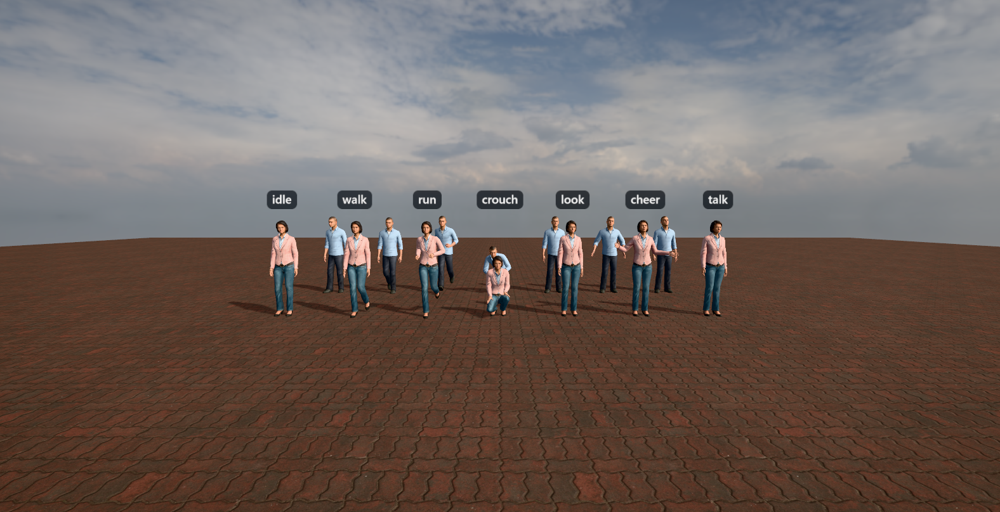 | 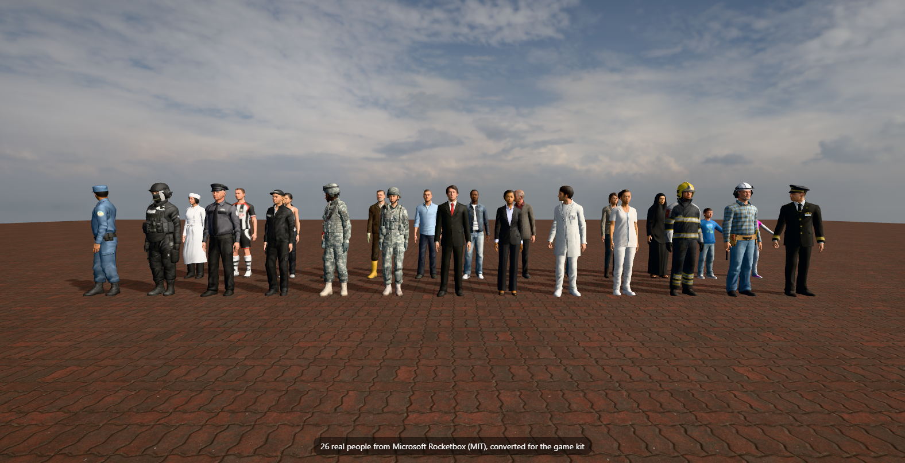 |

## Step 30: A new studio page, designed with React Bits, Fancy Components and COBE

**Request:** "use whatever github libraries you need for development of the product like Fancy Components, COBE, React Bits for designs".

**How the libraries are used:**
- **The page stays plain JavaScript, with no build step.** The components were read from their GitHub sources and ported:

| Part of the page | From | What was kept |
|---|---|---|
| The glowing aurora behind the hero (`design/aurora.js`) | React Bits **Aurora** | The WebGL2 shader unchanged (OKLCH colour ramp, simplex-noise layers, reaching toward the pointer, the intro reveal). The React wrapper became one function. |
| The light that follows the pointer on the step and game cards (`design/spotlight.js`) | React Bits **SpotlightCard** | The radial falloff, smoothing, proximity, border glow and press flare. |
| The shine sweeping across "Speak any game." (`design/text.js`) | React Bits **ShinyText** | The colour band, angle, smooth easing and pause between sweeps. |
| The rotating game ideas ("Say *a pirate battle at sunset*…") (`design/text.js`) | Fancy **TextRotate** | Letters rise in with a spring and the old word leaves upwards, now with the Web Animations API instead of Motion. |
| The globe of example worlds (`design/globe.js`) | **COBE** 0.6.4 from jsDelivr | Used as is. Picking an example (or the rotating line) swings it to that place; it can be dragged. |

- **Licences:** React Bits is MIT + Commons Clause, which allows use *as part of an application*, with its notice kept. Fancy and COBE are MIT. `public/design/THIRD_PARTY.md` has the notices, and the footer links to it.

**The page (`make.html`, `make.css`, `make.js`):**
- **Hero:** say or type an idea, with example chips (Paris heist, Caribbean pirates, New York chase, Monaco GP…) that fill the prompt and turn the globe.
- **How it works:** four steps, each naming the Meta model at work.
- **Gallery:** game cards with the test browser's screenshot and badges ("Meta's AI inside", "Real scanned world", "Real people").
  - The badges come from each game's code (`featuresOf` in `games.ts`).
  - Only games written by a Muse model are listed; hand-written tests and replaced versions are hidden.
- **Making a game:** a live view of the real steps (writing, testing, reviewing, ready), with the maker's own log lines, including what Meta's AI decided inside the game during the test. The new `GET /api/make/progress` provides them.
- **Playing:**
  - The game sits below a slim bar, beside a docked panel of Meta's AI. The first try floated the bar and panel over the game and hid its score line and meter.
  - Screenshots come from the new `GET /api/games/<id>/shot.png`.

| Hero | How it works | The gallery | Playing, with Meta's AI beside the game |
|---|---|---|---|
|  |  |  |  |

## Final check

Run these from the project folder to repeat the checks:

```bash
npm install
npm run typecheck   # result: no errors
npm test            # result: 42 tests, 42 passed, 0 failed
npm run demo        # result: rounds end escaped, caught, escaped, caught (5, 5, 7 and 6 steps)
npm run api:check   # needs .env; result: key works, 4 of 4 game models available
npm run api:try     # needs .env; plays round 1 on the real models (a few cents)
npm run api:try -- 2   # plays rounds 1 and 2, keeping the notebook (about 17 cents)
npm run design -- "your idea"   # needs .env for your own words; a few cents per level
npm start           # then open http://localhost:3000/levels.html (game maker) or /3d.html (3D bedroom)
```

## Not done yet

**Open issues from the real runs:**
- **The end-of-round review takes 17–35 seconds.** Run it in the background and show the report as soon as it is ready.
- **Speed:** `reasoning_effort: "minimal"` was tried in step 25 for the AI inside made games: 2–3 s instead of 5–7 s. The original Home Heist roles still use "low" and "medium".
- **The demo script was tuned for the offline guards.** Real guards need different tricks to show learning, for example hiding and darkness.
- **Cost check:** compare our estimates (roughly $3.5 in all by Nov 2) with the Billing page.
- **Speaking during play** goes through the page's microphone (the Speak button in the Enter box). It has not been tried with a real voice yet, only typing.
- **AI-written minds can still cheat in code:** in The Midnight Heist, "hunt the thief" walks to the thief's true position. The writer is told to give characters only what they could notice, but the code is not checked for this.

**Not tested yet:**
- **The browser has not been played by hand on the real models yet.** The server was started in Meta mode on Oct 28 and opened for the user.
- **The browser was checked only in Edge (headless).** Clicking and typing were tested through the API, not by hand.

**Next (Nov 2–4):**
- **Demo video and submission** (due Nov 4, 9 PM ET).
- **Playtests by hand:** a person playing several rounds of an AI-made game, to see the characters learn.
- **The four graphics fixes from step 24:** car detail, grandstands behind barriers, the start line.

**Not built yet** (the plan is in [DESIGN.md](DESIGN.md#11-schedule)):
- **Photo becomes a level:** Muse Spark names the objects, SAM 3.1 cuts them out, and a world builder writes the room file.
- **A picture of the scene every step:** Muse Image.
- **AI-against-AI training and the two charts:** guard catch rate, and world-model mistakes before and after lessons.
